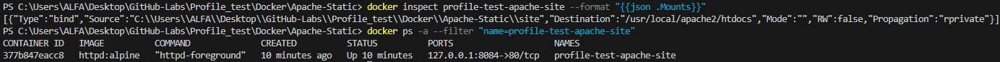
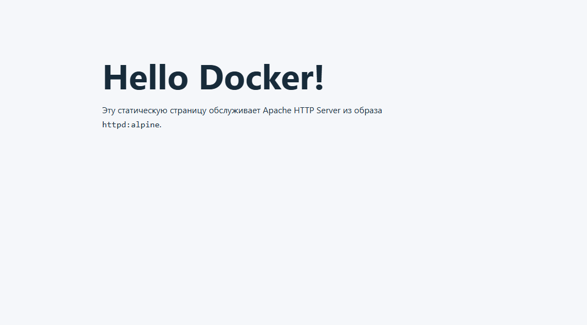
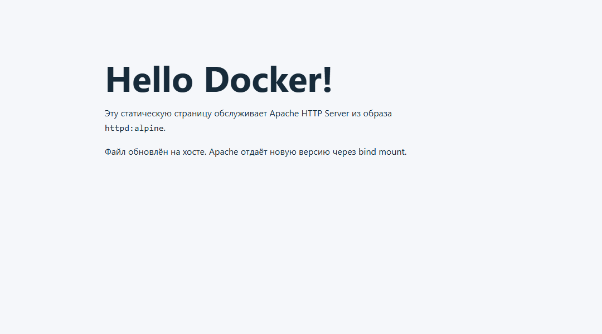

# Docker Image Library — статический сайт на Apache

Цель работы — запустить Apache HTTP Server из готового образа Docker Hub и проверить, как сервер отдаёт статическую страницу из папки хоста. В работе используются Docker CLI, Docker Desktop с Linux-контейнерами, образ `httpd:alpine` и HTML. [Задание преподавателя](https://github.com/rurewa/imfua/blob/main/content/Docker/ImageLibrary/Apache%2BStaticSite.md) · [Порядок оформления практики](https://github.com/rurewa/imfua/blob/main/content/StudentPracticalsLabs/ready_made_docker_image.md)

## Поиск и загрузка образа

В PowerShell из корня репозитория выполните следующие команды.

```powershell
cd Docker/Apache-Static
docker version
Get-NetTCPConnection -LocalPort 8084 -State Listen -ErrorAction SilentlyContinue
docker search --filter is-official=true httpd
docker pull httpd:alpine
docker image ls httpd:alpine
```

В проверочном запуске клиент и Docker Engine сообщили версию `29.4.0`. Порт `8084` был свободен, а поиск Docker Hub подтвердил, что `httpd` — официальный образ. [Образ Apache HTTP Server на Docker Hub](https://hub.docker.com/_/httpd)

## Запуск

```powershell
$siteDirectory = (Resolve-Path -LiteralPath site).Path
docker run -d --name profile-test-apache-site --publish 127.0.0.1:8084:80 --mount "type=bind,source=$siteDirectory,target=/usr/local/apache2/htdocs,readonly" httpd:alpine
```

Команда создаёт контейнер `profile-test-apache-site`. Папка `site/` с файлом `index.html` подключается к каталогу Apache `/usr/local/apache2/htdocs` в режиме только для чтения. Сайт доступен на хосте по адресу `http://127.0.0.1:8084/`. [Документация Docker по bind mount](https://docs.docker.com/engine/storage/bind-mounts/)

## Проверка контейнера

```powershell
docker ps -a --filter name=profile-test-apache-site
docker port profile-test-apache-site 80/tcp
docker inspect --format '{{range .Mounts}}{{println .Type .RW .Destination}}{{end}}' profile-test-apache-site
docker exec profile-test-apache-site httpd -v
docker exec profile-test-apache-site cat /etc/os-release
docker stats --no-stream profile-test-apache-site
docker logs --tail 10 profile-test-apache-site
curl.exe --silent --show-error --include http://127.0.0.1:8084/
```

- `docker ps -a` показала статус `Up`. Порт контейнера `80/tcp` доступен на `127.0.0.1:8084`.
- `docker inspect` показала `bind false /usr/local/apache2/htdocs`, где `false` означает, что контейнер не может записывать в смонтированный каталог.
- `docker exec` показала Apache `2.4.71` и Alpine Linux `3.24.4`. `docker stats --no-stream` вернула показатели контейнера.
- Запрос `GET /` вернул HTTP `200` и HTML с заголовком «Hello Docker!». В журнале доступа Apache появилась запись о запросе.

### Вывод команд Docker



### Исходная страница



## Изменение HTML на хосте

Сохраните вывод команды ниже, измените текст в `site/index.html` и обновите страницу по адресу `http://127.0.0.1:8084/`. Затем повторите `docker inspect`.

```powershell
docker inspect --format '{{.Id}} {{.State.StartedAt}} {{.RestartCount}}' profile-test-apache-site
curl.exe --silent --show-error --include http://127.0.0.1:8084/
```

В проверочном запуске после добавления абзаца «Файл обновлён на хосте» запрос снова вернул HTTP `200`, уже с новым текстом. Идентификатор и время запуска контейнера совпали с исходными, счётчик перезапусков остался равен `0`. Apache видит изменение сразу, потому что при запросе читает файл из каталога хоста, подключённого через bind mount.

### Страница после изменения файла



Оба снимка страницы сделаны в Chrome с адреса работающего контейнера.

## Остановка и повторный запуск

Команда `docker stop` останавливает только контейнер этой работы. Команда `docker start` запускает тот же контейнер с сохранёнными настройками.

```powershell
docker stop profile-test-apache-site
docker start profile-test-apache-site
```
