# Лабораторная № 15 — Dockerfile, Flask и Python

Цель работы — собрать Docker-образ небольшого Flask-приложения и проверить два маршрута в запущенном контейнере. Flask — веб-фреймворк Python, который связывает URL с функциями приложения. [Методичка преподавателя](https://github.com/rurewa/imfua/blob/main/content/Docker/Dockerfile/Flask+Python_Mini.md)

## Структура проекта

| Файл | Назначение |
| --- | --- |
| [app.py](app.py) | Возвращает приветствие на `/` и статус приложения на `/health`. |
| [requirements.txt](requirements.txt) | Фиксирует зависимость `Flask==3.0.0`. |
| [Dockerfile](Dockerfile) | Описывает сборку и запуск контейнера. |
| [.dockerignore](.dockerignore) | Исключает кеш Python, файлы Git, `.env`, README и скриншоты из контекста сборки. |
| [screenshots/](screenshots/) | Снимки выполненных проверок. |

## Сборка и запуск

Dockerfile берёт за основу `python:3.11-slim`, задаёт рабочий каталог `/app` и устанавливает зависимости из `requirements.txt`. Затем он копирует приложение, объявляет порт 5000 и запускает `python app.py`. [Официальный образ Python](https://hub.docker.com/_/python)

Выполните команды в PowerShell из корня `Profile_test`.

~~~powershell
Set-Location Docker/Flask-Python
docker build -t profile-test-flask-lab15 .
docker image ls profile-test-flask-lab15
docker run -d --name profile-test-flask-lab15 -p 127.0.0.1:8089:5000 profile-test-flask-lab15
~~~

Порт 8082 из методички был занят другой лабораторной, поэтому использован свободный порт 8089. Flask слушает `0.0.0.0:5000` внутри контейнера. На хосте порт опубликован только на `127.0.0.1`.

В `app.run()` установлен `debug=False`. В учебном контейнере это отключает интерактивный отладчик Flask и автоматическую перезагрузку при изменении кода. Встроенный сервер Flask используется для локальной проверки. [Документация Flask](https://flask.palletsprojects.com/en/stable/server/)

## Проверка приложения

| Адрес | Ожидаемый и полученный ответ | HTTP |
| --- | --- | --- |
| [Главная страница](http://127.0.0.1:8089/) | `Hello, Docker! Привет из Flask!` | 200 |
| [Статус приложения](http://127.0.0.1:8089/health) | `{"status":"healthy"}` | 200 |

~~~powershell
docker ps -a --filter name=profile-test-flask-lab15
docker logs profile-test-flask-lab15
docker exec profile-test-flask-lab15 python --version
docker exec profile-test-flask-lab15 python -m pip show Flask
curl.exe -i http://127.0.0.1:8089/
curl.exe -i http://127.0.0.1:8089/health
~~~

Сборка завершилась с кодом 0. В контейнере подтверждены Python **3.11.18** и Flask **3.0.0**. В журналах видно `Debug mode: off`. Chrome отобразил русские символы на главной странице, а `/health` вернул JSON с типом `application/json`.

## Перезапуск и остановка

~~~powershell
docker restart profile-test-flask-lab15
docker ps -a --filter name=profile-test-flask-lab15
curl.exe -i http://127.0.0.1:8089/
curl.exe -i http://127.0.0.1:8089/health
~~~

После перезапуска тот же контейнер вернулся в состояние `Up`. Оба маршрута повторно вернули HTTP 200, значение `status` осталось `healthy`.

Для остановки и запуска существующего контейнера используйте следующие команды.

~~~powershell
docker stop profile-test-flask-lab15
docker start profile-test-flask-lab15
~~~

## Скриншоты

### Структура проекта

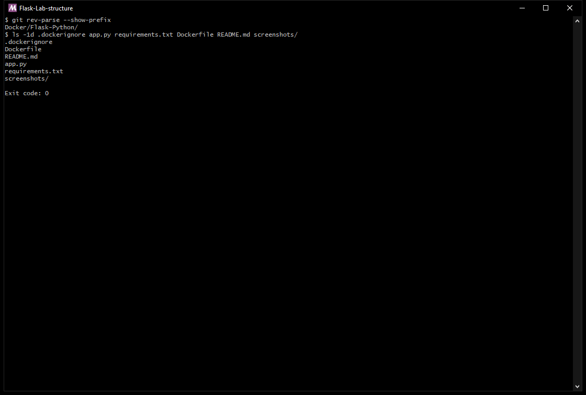

### Код Flask-приложения

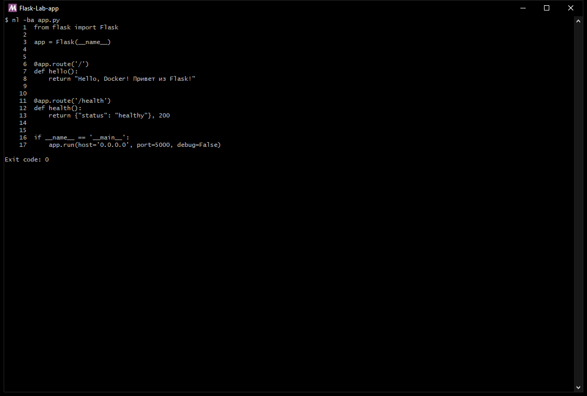

### Версия Flask в requirements.txt

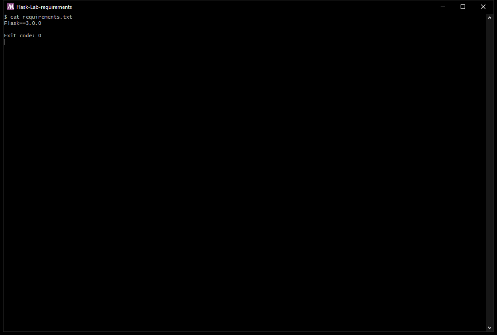

### Dockerfile

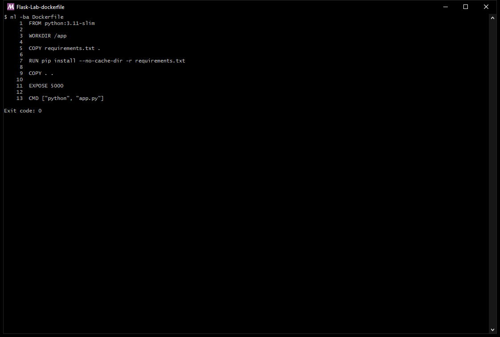

### Сборка Docker-образа

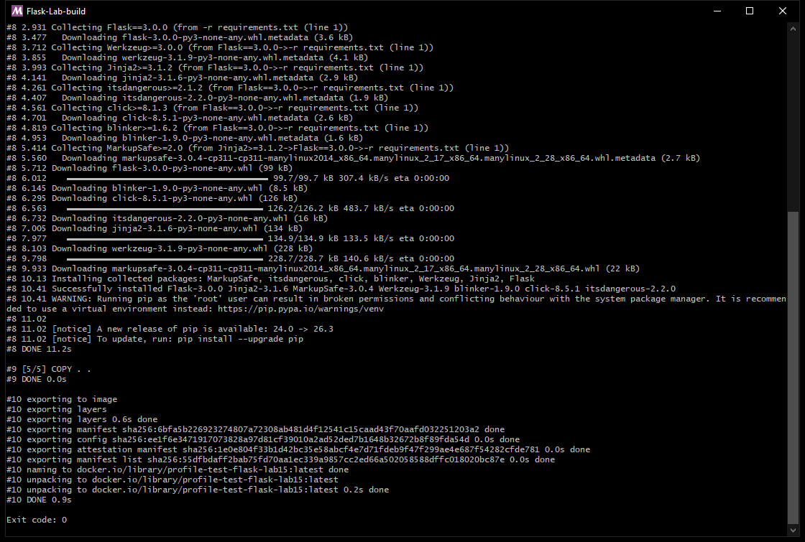

### Собранный образ и версии Python и Flask

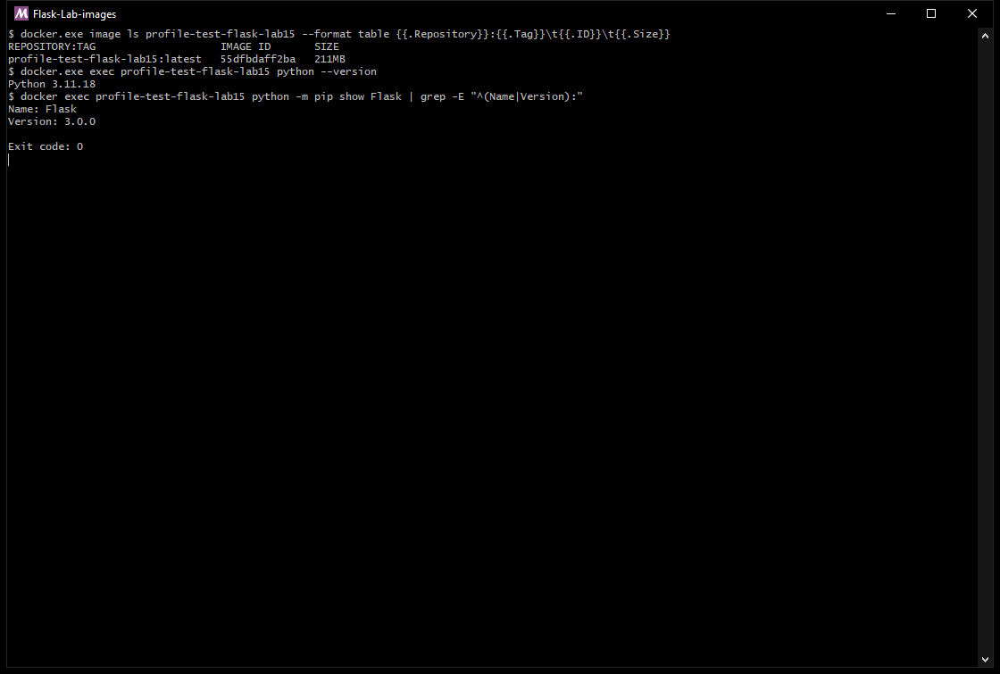

### Запущенный контейнер

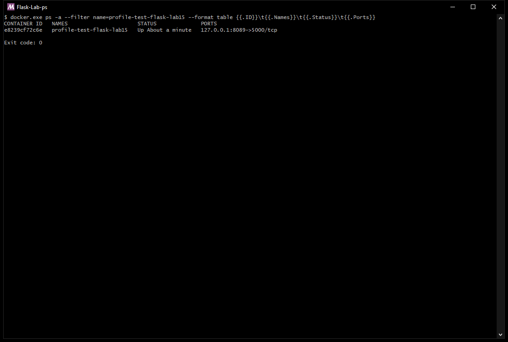

### Главная страница в браузере

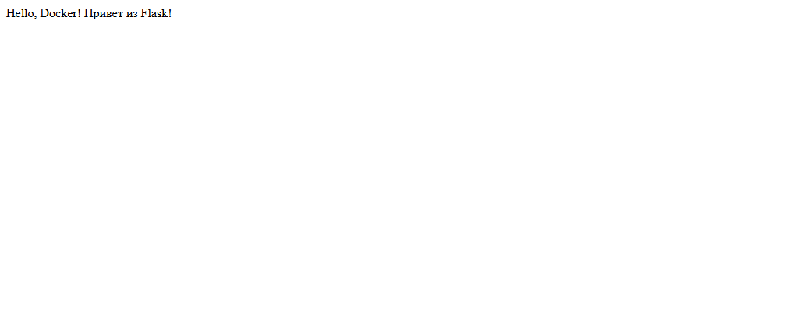

### Ответ /health в браузере

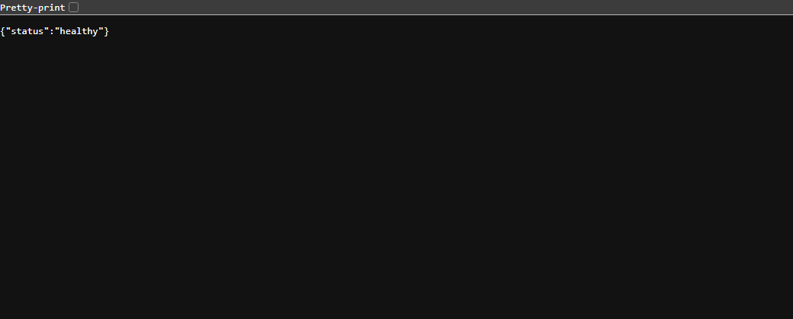

### HTTP 200 на обоих маршрутах

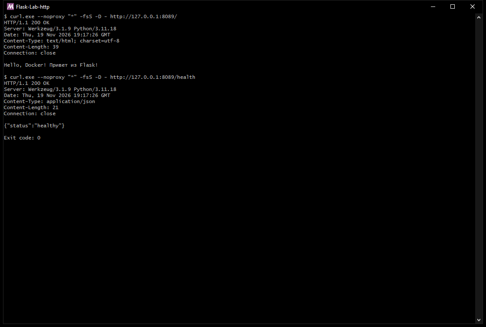

### Журнал Flask

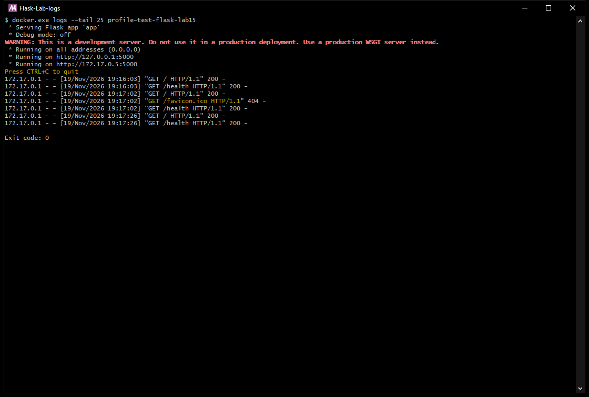

### Повторная проверка после перезапуска

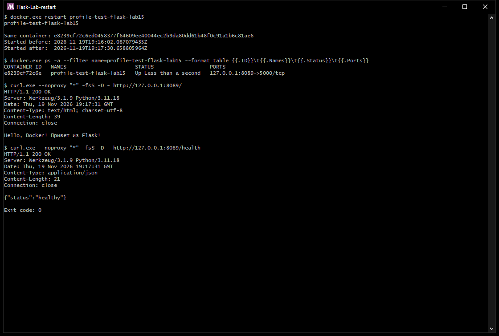
