# Лабораторная № 11 — Docker Compose и Joomla

Цель — развернуть CMS Joomla с MariaDB, установить сайт через браузер и проверить, что данные сохраняются после перезапуска. Сайт доступен локально. GitHub хранит конфигурацию, документацию и снимки выполнения. [Методичка преподавателя](https://github.com/rurewa/imfua/blob/main/content/Docker/DockerCompose/joomla.md)

## Сервисы и хранение данных

Joomla работает на PHP и Apache, а MariaDB хранит статьи, учётные записи и настройки CMS. Сервис `joomla` подключается к `db:3306` по общей сети `joomla-network`. MariaDB доступна внутри этой сети. Compose-проект называется `profile-test-joomla-lab`.

| Сервис | Официальный образ | Том |
| --- | --- | --- |
| `joomla` | `joomla:6.2.0-php8.4-apache` | `profile-test-joomla-lab_joomla_data` → `/var/www/html` |
| `db` | `mariadb:11.4.13` | `profile-test-joomla-lab_db_data` → `/var/lib/mysql` |

Проверка готовности `healthcheck.sh --connect --innodb_initialized` подтверждает, что MariaDB принимает соединения и InnoDB готова. У Joomla зависимость `condition: service_healthy`. Оба сервиса используют `restart: unless-stopped`. [Требования Joomla](https://manual.joomla.org/docs/next/get-started/technical-requirements/) · [MariaDB Healthcheck](https://mariadb.com/docs/server/server-management/automated-mariadb-deployment-and-administration/docker-and-mariadb/using-healthcheck-sh)

## Структура проекта

| Файл | Назначение |
| --- | --- |
| [compose.yaml](compose.yaml) | Сервисы, общая сеть, набор томов и порт. |
| [.env.example](.env.example) | Пример параметров для локального `.env`. |
| [.gitignore](.gitignore) | Исключает локальные пароли и временные файлы. |
| [screenshots](screenshots/) | Снимки терминала и браузера. |

## Подготовка и запуск

Из каталога `Docker/Joomla` в PowerShell скопируйте пример и задайте в `.env` два разных локальных пароля. `MARIADB_ROOT_PASSWORD` нужен при инициализации MariaDB. `JOOMLA_DB_PASSWORD` используется для пользователя `joomla_user`. При первом запуске MariaDB создаёт базу `joomla_db` и этого пользователя. Пароли базы задаются при создании тома. Для уже установленного сайта изменение `.env` само по себе пароли в MariaDB не меняет.

~~~powershell
Copy-Item .env.example .env
notepad .env
docker compose config --quiet
docker compose up -d
docker compose ps -a
~~~

Joomla привязана к `127.0.0.1`. При необходимости задайте другой свободный `JOOMLA_PORT` в `.env` и замените его в адресах ниже. `docker compose config` раскрывает подставленные значения, поэтому для проверки без вывода используется `--quiet`.

- Сайт — [http://localhost:8083](http://localhost:8083/).
- Админ-панель — [http://localhost:8083/administrator](http://localhost:8083/administrator/).
- Учебная статья — [«Проверка Docker Compose»](http://localhost:8083/index.php?option=com_content&view=article&id=1) в проверенной установке.

## Веб-установка

1. Откройте сайт и укажите название `Joomla Docker Lab`. В проверенной установке использован английский интерфейс мастера.
2. Задайте имя и пароль тестового администратора. Для проверки использован учебный адрес `lab-admin@example.test`.
3. Выберите MySQLi. Укажите сервер `db`, пользователя `joomla_user`, базу `joomla_db` и пароль из `JOOMLA_DB_PASSWORD`. Префикс таблиц в проверенной установке — `jlab_`.
4. Нажмите **Install Joomla**, затем **Open Site**. В Joomla 6.2.0 эта кнопка завершает удаление `installation`. Проверьте, что открывается установленный сайт.
5. Войдите в `/administrator/`. В разделе **Content → Articles** создайте статью **«Проверка Docker Compose»**, задайте алиас `docker-compose-check` и сохраните её со статусом **Published** и признаком **Featured**. Статья появится на главной.

## Проверка и управление

~~~powershell
docker compose ls
docker compose ps -a
docker compose logs --tail 20 db
docker compose logs --tail 20 joomla
docker network inspect profile-test-joomla-lab_joomla-network
docker volume ls --filter label=com.docker.compose.project=profile-test-joomla-lab
docker compose exec db mariadb --user=joomla_user --password joomla_db
~~~

MariaDB запросит пароль интерактивно. В проверенной установке запросы подтверждают подключение, количество таблиц и состояние статьи.

~~~sql
SELECT DATABASE(), VERSION();
SELECT COUNT(*) FROM information_schema.TABLES WHERE TABLE_SCHEMA = DATABASE();
SELECT id, title, state, featured FROM jlab_content WHERE alias = 'docker-compose-check';
~~~

Для остановки и повторного запуска с теми же томами используйте команды ниже. Просмотр логов в реальном времени завершается клавишами `Ctrl+C`.

~~~powershell
docker compose logs -f joomla
docker compose stop
docker compose start
docker compose restart
~~~

## Результаты

| Проверка | Результат |
| --- | --- |
| Запуск Compose | `docker compose config` и `docker compose up -d` прошли. Joomla работает на `127.0.0.1:8083`, MariaDB — `healthy`. |
| Веб-установка | Мастер завершён, `configuration.php` создан в томе Joomla, каталог `installation` удалён установщиком. |
| Сайт и админ-панель | Обе страницы ответили HTTP 200, вход учебного администратора подтверждён. |
| MariaDB | Подключение из контейнера Joomla с установленной конфигурацией подтвердило `joomla_db`, пользователя `joomla_user`, сервер `db` и **76 таблиц**. |
| Статья | ID `1`, `state=1` и `featured=1`. Статья видна на главной и открывается отдельно. |
| Перезапуск | `docker compose restart` перезапустил два контейнера. Их ID и тома сохранились. Сайт, панель и статья снова ответили HTTP 200. Имя сайта, количество таблиц и запись статьи совпали до и после перезапуска. |

## Уточнения к методичке

- `docker compose up -d` запускает сервисы в фоновом режиме. Флаг `-d` — сокращение `--detach`.
- В привязке `127.0.0.1:8083:80` первый порт относится к хосту, второй — к Apache внутри контейнера. Порт 8082 в рабочей среде занят Adminer.
- Короткая форма `depends_on` определяет порядок запуска. Готовность базы проверяется `healthcheck` и условием `service_healthy`.
- Версии образов зафиксированы. MariaDB настроена через переменные `MARIADB_*`, пароли подставляются из локального `.env`. Для управления установленным сайтом достаточно команд, сохраняющих оба тома.

## Скриншоты

### Структура проекта

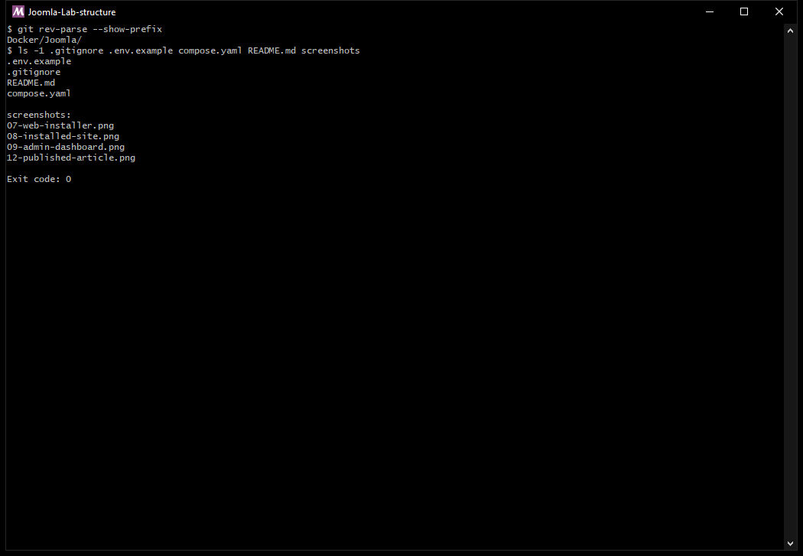

### Содержимое compose.yaml

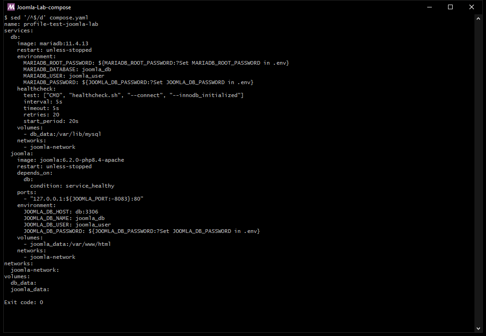

### Разрешённая конфигурация Compose без паролей

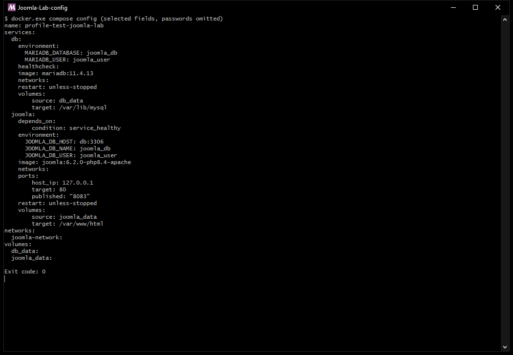

### Контейнеры, сеть и тома

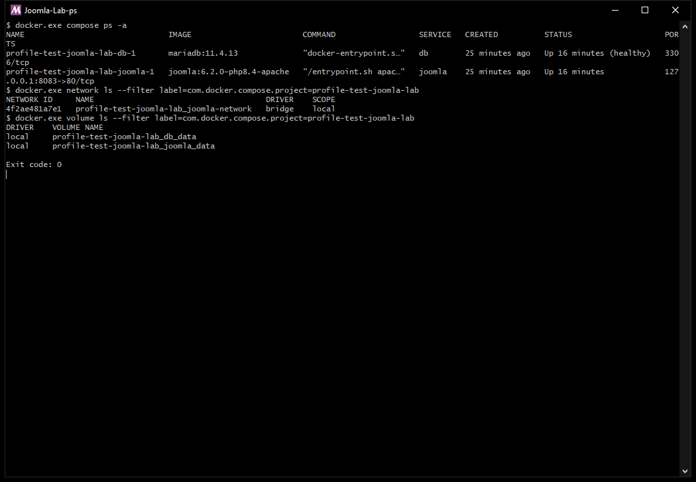

### Логи MariaDB

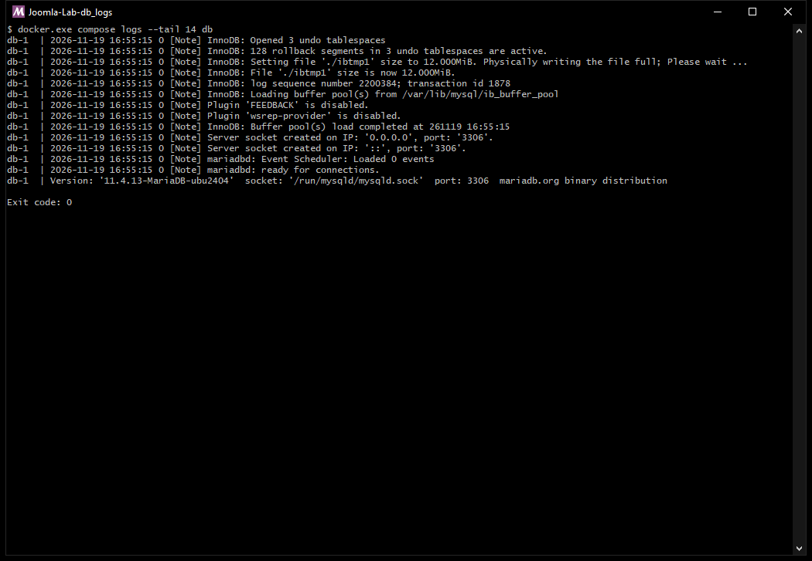

### Старт Apache и Joomla

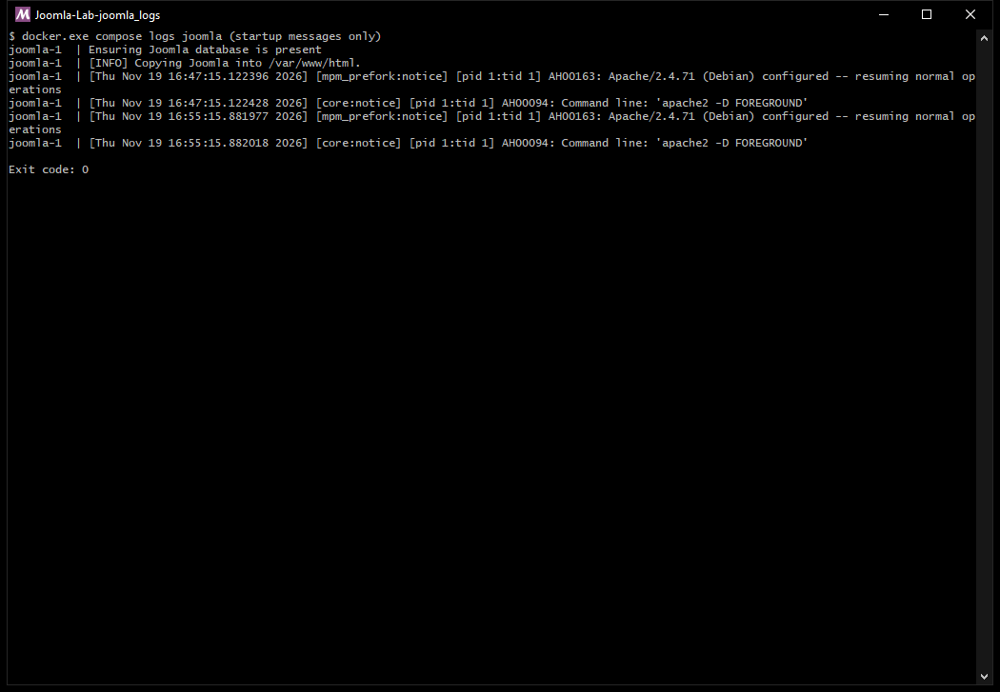

### Веб-мастер Joomla до ввода данных

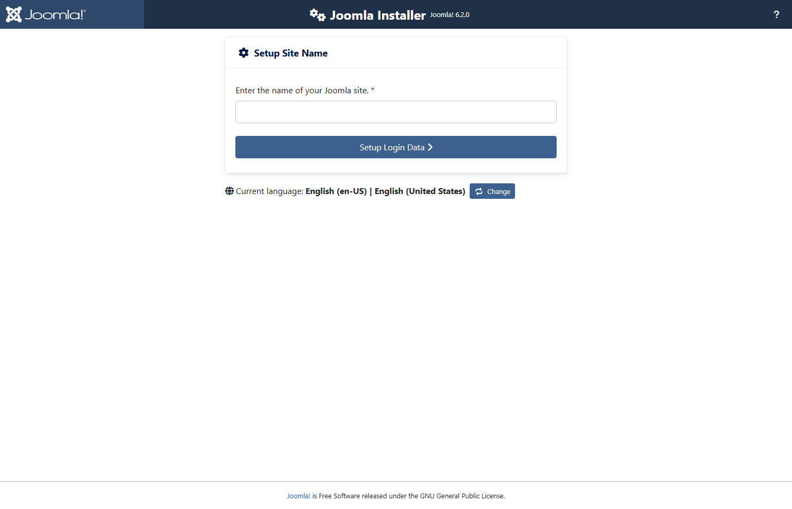

### Главная страница после установки

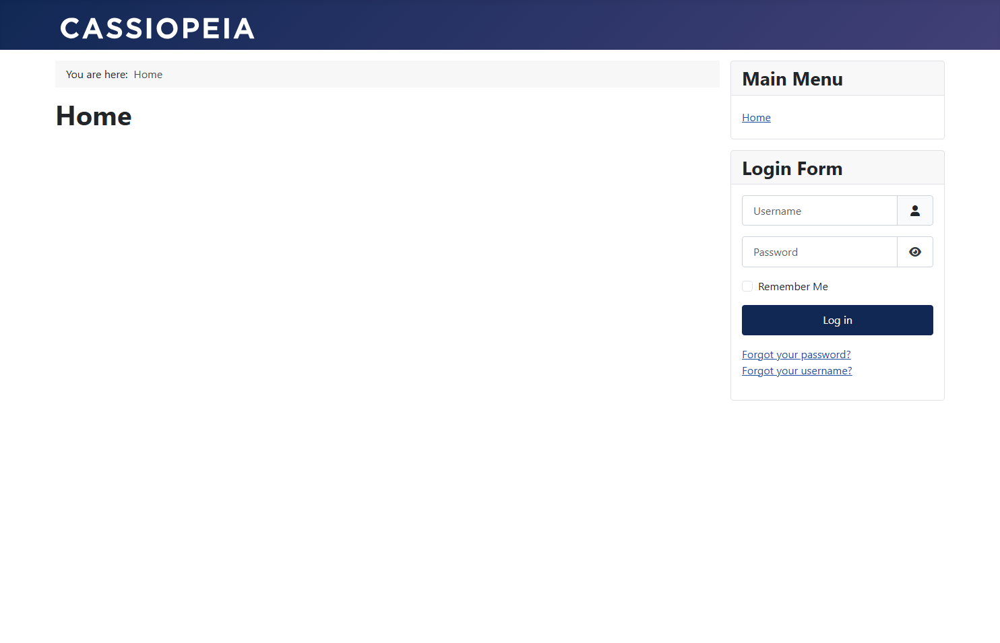

### Панель администратора после входа

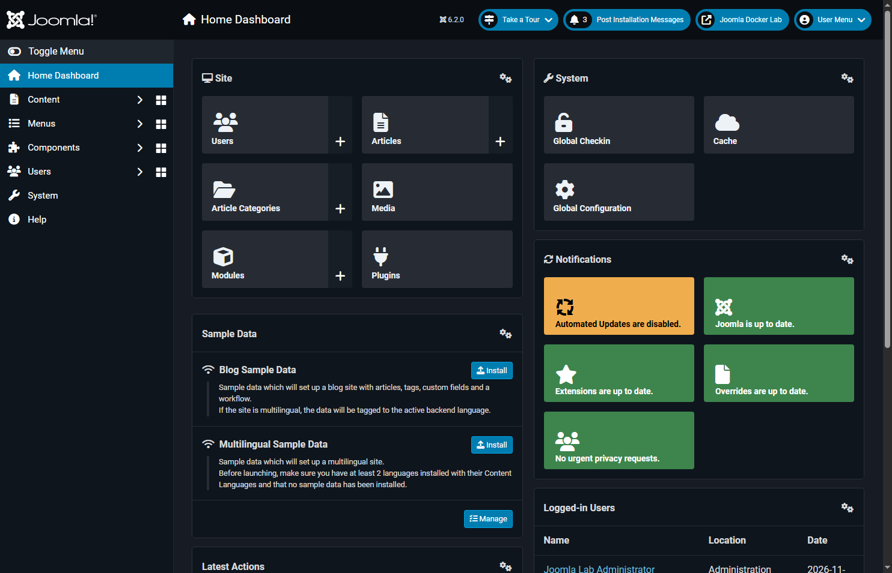

### Подключение и таблицы MariaDB из контейнера Joomla

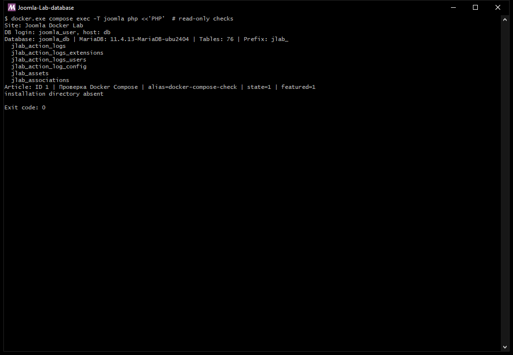

### HTTP и данные после перезапуска двух сервисов

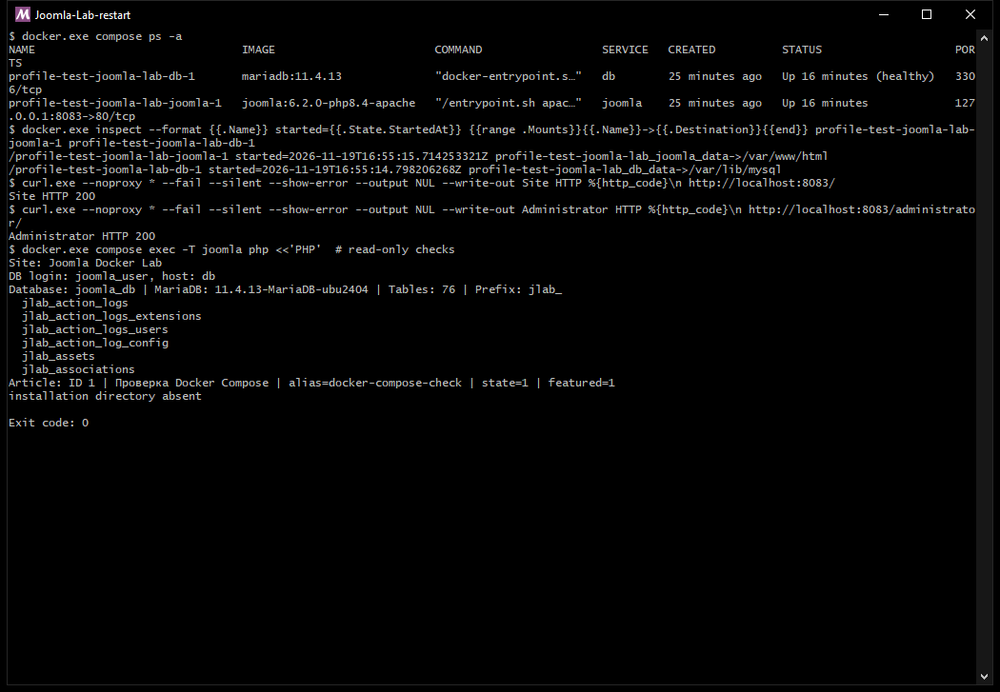

### Опубликованная статья «Проверка Docker Compose»

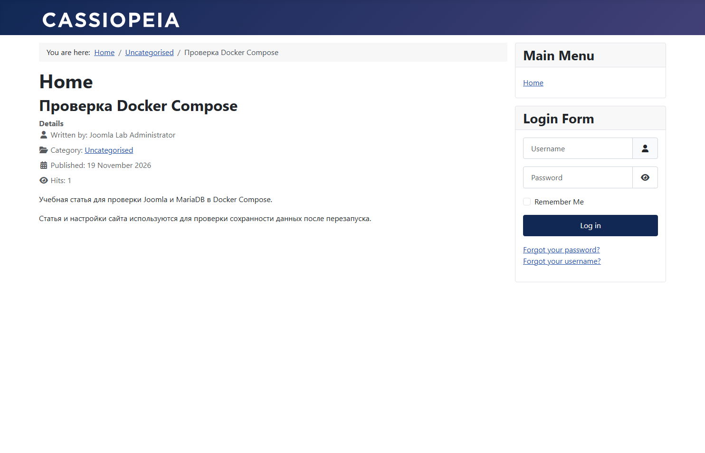
