# Лабораторная № 12 — Docker Compose — MySQL + phpMyAdmin

Цель — развернуть MySQL и phpMyAdmin отдельными сервисами Compose, создать учебную таблицу через браузер и проверить, что данные сохраняются после перезапуска. Проверенная установка работает локально. [Методичка преподавателя](https://github.com/rurewa/imfua/blob/main/content/Docker/DockerCompose/mySQLphpMyAdmin.md)

## Сервисы и ресурсы

| Сервис | Образ | Назначение |
| --- | --- | --- |
| `mysql` | `mysql:8.0.46` | MySQL Community Server. Хранит схему и данные. |
| `phpmyadmin` | `phpmyadmin:5.2.3-apache` | Веб-интерфейс работы с MySQL. Apache слушает порт `80` внутри контейнера. |

Compose-проект называется `profile-test-mysql-pma-lab`. Оба сервиса подключены к общей сети `mysql-pma-network`. phpMyAdmin использует `PMA_HOST=mysql`, `PMA_PORT=3306` и `UPLOAD_LIMIT=300M`. MySQL доступен через сеть Compose, а публикация HTTP ограничена адресом `127.0.0.1`. [Настройки образа phpMyAdmin](https://docs.phpmyadmin.net/en/latest/setup.html#docker-environment-variables)

Том `profile-test-mysql-pma-lab_mysql_data` подключён к `/var/lib/mysql`. Он сохраняет базы между запусками. Для обоих сервисов установлено `restart: unless-stopped`. MySQL переходит в `healthy` после успешного `SELECT 1` через TCP под учебным пользователем в `my_database`. phpMyAdmin ждёт этого состояния через `condition: service_healthy`.

## Структура проекта

| Файл или каталог | Содержимое |
| --- | --- |
| [compose.yaml](compose.yaml) | Два сервиса, проверка готовности, сеть и том. |
| [.env.example](.env.example) | Порт и демонстрационные значения паролей. |
| [.gitignore](.gitignore) | Исключения для локального `.env` и файлов захвата. |
| [screenshots/](screenshots/) | Снимки фактических проверок. |

## Запуск и вход

Из каталога `Docker/MySQL-phpMyAdmin` в PowerShell скопируйте пример, откройте `.env` и замените оба демонстрационных значения разными локальными паролями. `MYSQL_ROOT_PASSWORD` применяется при инициализации MySQL, а `MYSQL_PASSWORD` предназначен для `my_user`. `PMA_WEB_PORT` задаёт HTTP-порт. При первом запуске образ MySQL создаёт `my_database` и выделяет пользователю `my_user` права на неё.

~~~powershell
Copy-Item .env.example .env
notepad .env
docker compose config --quiet
docker compose up -d
docker compose ps -a
~~~

Откройте [http://localhost:8085/](http://localhost:8085/), войдите как `my_user` с паролем из `MYSQL_PASSWORD` и выберите `my_database`. В уже инициализированном томе пароли меняются в MySQL. Редактирование `.env` само по себе их не меняет.

## Учебная таблица

В `my_database` откройте вкладку **SQL** и выполните команды. В проверенной установке `CREATE TABLE`, `INSERT` и `SELECT` выполнены через веб-интерфейс phpMyAdmin. Имена и группы вымышлены.

~~~sql
CREATE TABLE students (
    id INT NOT NULL AUTO_INCREMENT,
    name VARCHAR(100) NOT NULL,
    group_name VARCHAR(30) NOT NULL,
    PRIMARY KEY (id)
) ENGINE=InnoDB DEFAULT CHARSET=utf8mb4;

INSERT INTO students (name, group_name) VALUES
    ('Студент Альфа', 'DEV-01'),
    ('Студент Бета', 'DEV-01'),
    ('Студент Гамма', 'DEV-02');

SELECT id, name, group_name FROM students ORDER BY id;
~~~

| id | name | group_name |
| --- | --- | --- |
| 1 | Студент Альфа | DEV-01 |
| 2 | Студент Бета | DEV-01 |
| 3 | Студент Гамма | DEV-02 |

Во вкладке **Structure** проверьте три поля. `id` имеет тип `INT`, первичный ключ и `AUTO_INCREMENT`. `name` — `VARCHAR(100) NOT NULL`, `group_name` — `VARCHAR(30) NOT NULL`.

## Проверка и управление

~~~powershell
docker compose ls
docker compose ps -a
docker compose logs --tail 20 mysql
docker compose logs --tail 20 phpmyadmin
docker network inspect profile-test-mysql-pma-lab_mysql-pma-network
docker volume inspect profile-test-mysql-pma-lab_mysql_data
docker compose exec mysql mysql --protocol=TCP --host=127.0.0.1 --user=my_user --password my_database
~~~

Клиент MySQL запросит пароль интерактивно. Для проверки выполните `SHOW CREATE TABLE students;` и `SELECT id, name, group_name FROM students ORDER BY id;`. Выход из клиента — `exit`. Чтобы завершить просмотр `docker compose logs -f phpmyadmin`, нажмите `Ctrl+C`.

Команды остановки, повторного запуска и перезапуска сохраняют том.

~~~powershell
docker compose stop
docker compose start
docker compose restart
~~~

## Результаты

| Проверка | Результат |
| --- | --- |
| Compose и HTTP | Конфигурация валидна. MySQL `healthy`, phpMyAdmin отвечает HTTP 200 на `127.0.0.1:8085`. |
| Вход и доступ | Вход под `my_user` прошёл. База `my_database` доступна, вкладка **Structure** показывает `students`. |
| SQL | Запрос `SELECT` вернул три строки и ожидаемые группы. Структура проверена в браузере и через `information_schema.COLUMNS`. |
| Перезапуск | `docker compose restart` перезапустил два контейнера этого проекта. Тот же том сохранил структуру и все три записи. Вход и `SELECT` в phpMyAdmin после перезапуска подтверждены. |
| Логи | MySQL готов к соединениям, Apache запустился. Предупреждение Apache `AH00558` связано с отсутствием `ServerName`. HTTP и операции с данными прошли. |

Сообщение на панели относится к необязательному хранилищу расширенных настроек phpMyAdmin. Для входа, работы с таблицей и запросов SQL этой настройки не требуется.

## Отличия от методички

- Порт 8083 занят Joomla, а 8084 — Apache. Опубликован свободный порт `8085` только на `127.0.0.1`. Порт MySQL `3306` доступен внутри сети проекта.
- В примере короткий `depends_on` задаёт порядок запуска. Здесь `healthcheck` и `service_healthy` проверяют успешный SQL-запрос к базе перед запуском phpMyAdmin.
- Привязка к конкретному `PMA_HOST` позволяет работать со своим сервисом `mysql`. Для входа используется `my_user`, оба пароля хранятся в локальном `.env`. `docker compose config` подставляет пароли в вывод, поэтому для проверки конфигурации используется `--quiet`.
- Версии образов зафиксированы. MySQL 8.0.46 выбран для совместимости с заданием и используется в локальной среде после завершения поддержки ветки 8.0. [Примечания к релизу MySQL 8.0](https://dev.mysql.com/doc/relnotes/mysql/8.0/en/)

## Скриншоты

### Структура проекта

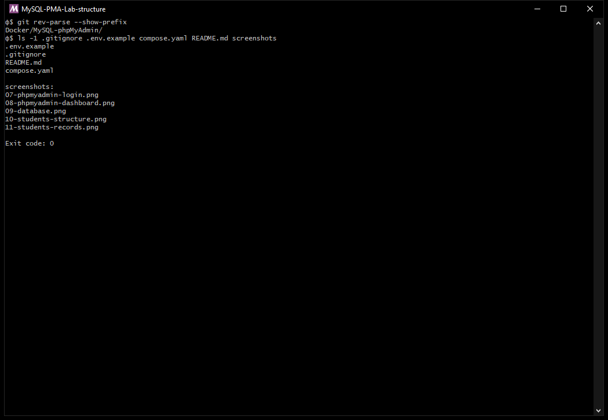

### Содержимое compose.yaml

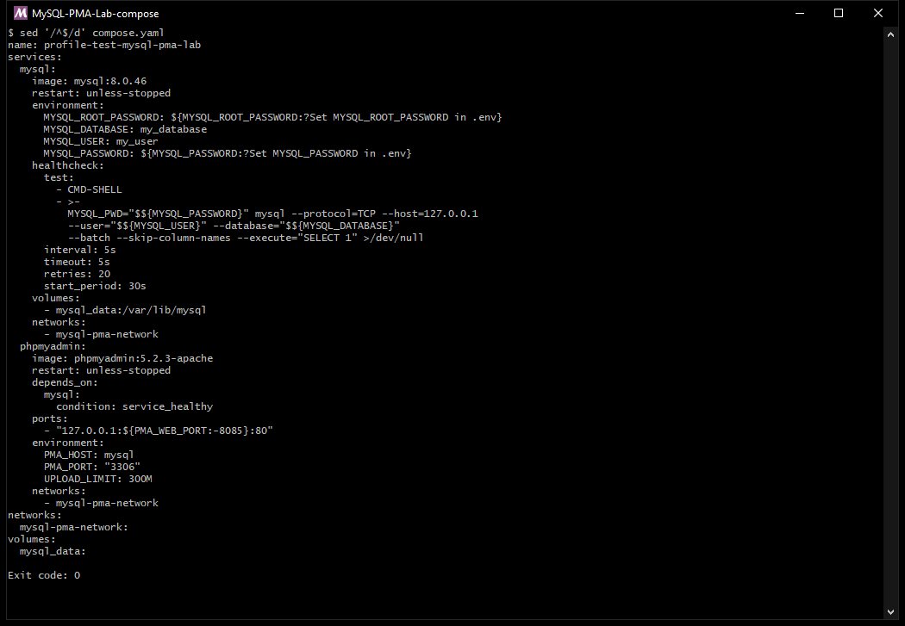

### Проверка и разрешённая конфигурация без паролей

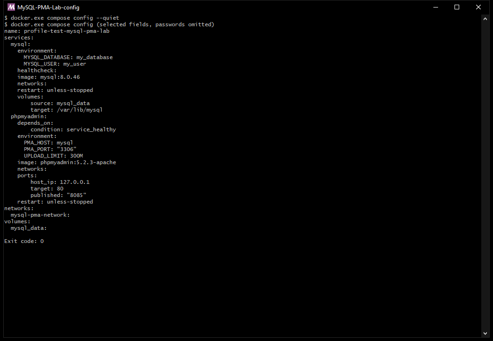

### Контейнеры, сеть и том

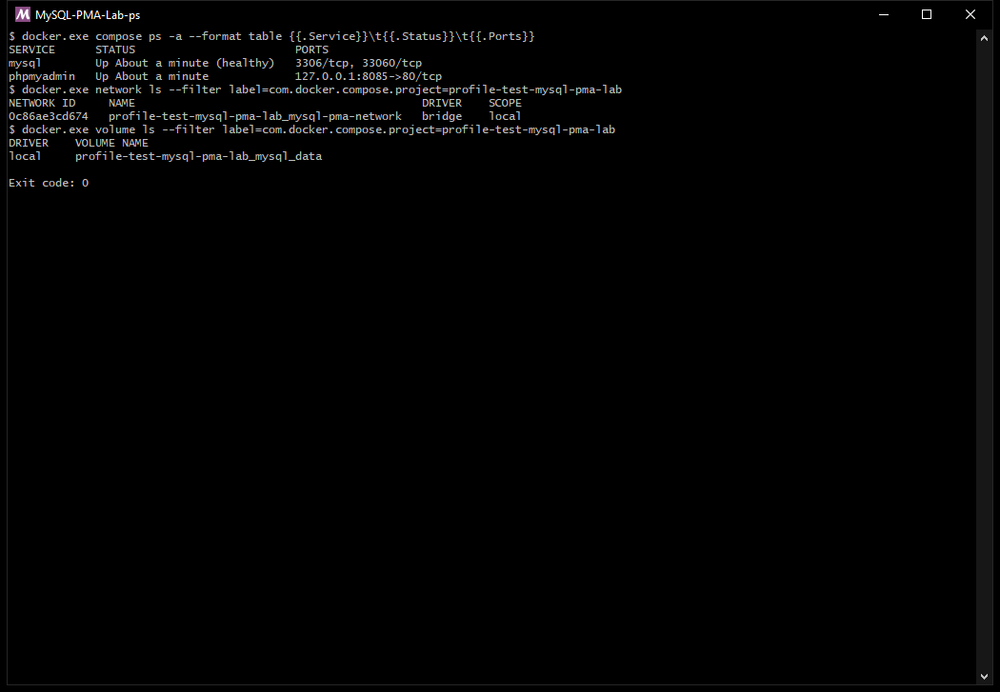

### Инициализация и готовность MySQL

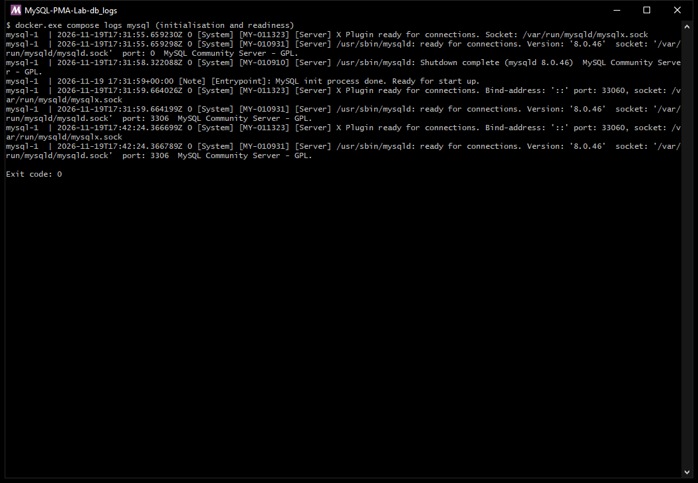

### Запуск Apache в phpMyAdmin

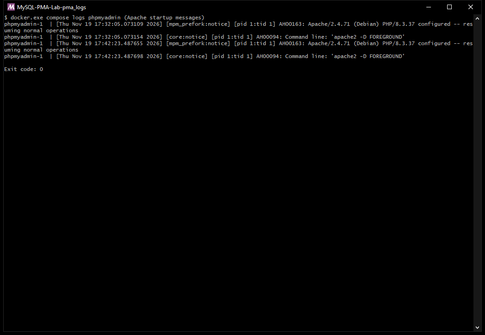

### Форма входа до ввода пароля

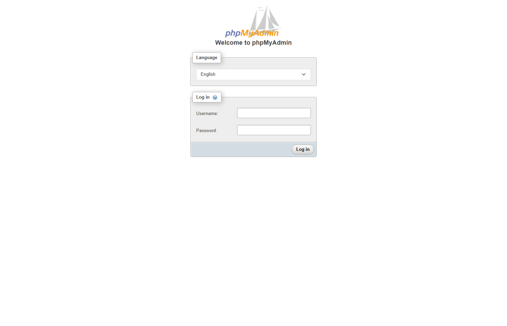

### Интерфейс phpMyAdmin после авторизации

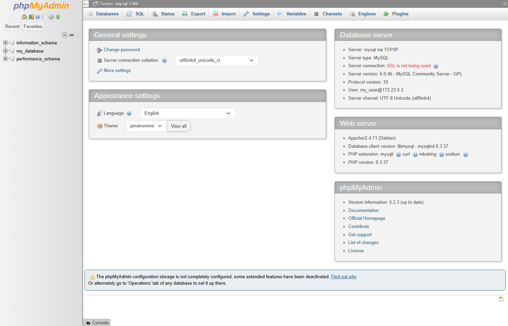

### База my_database и таблица students

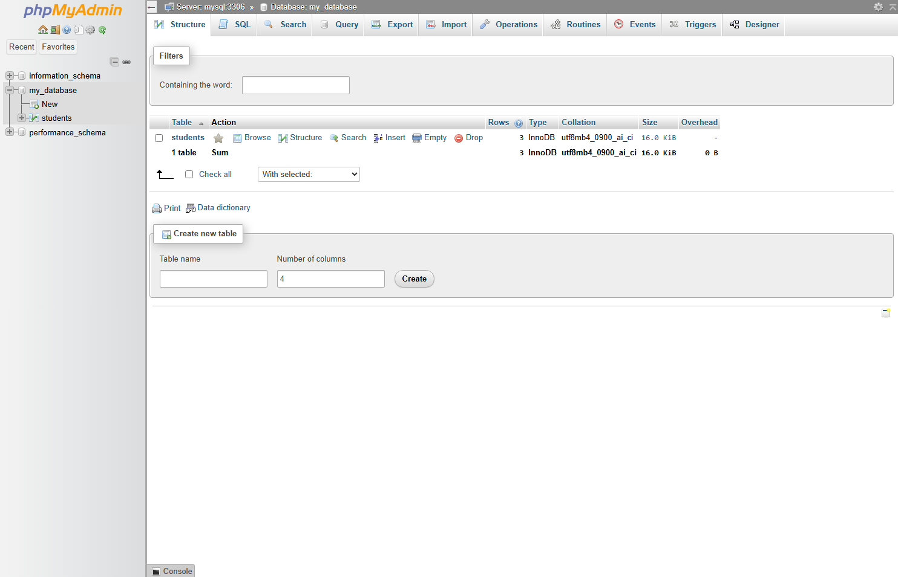

### Структура таблицы students

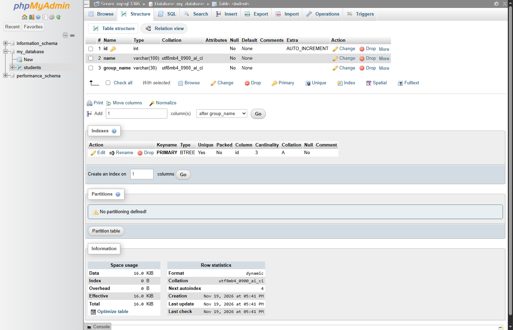

### Результат SELECT в phpMyAdmin

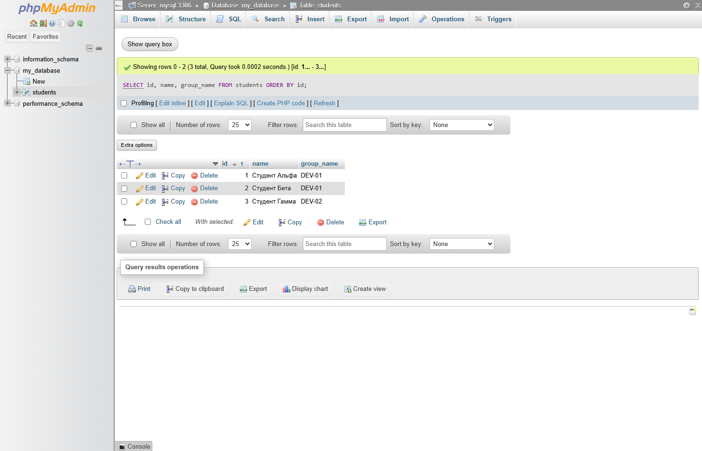

### HTTP и те же данные после перезапуска

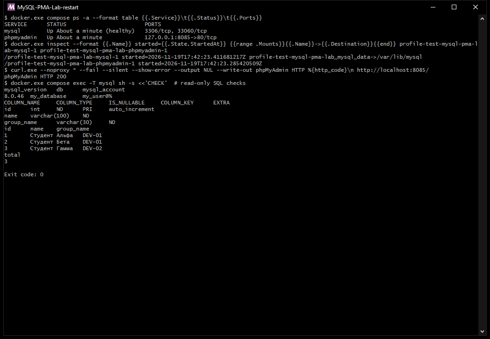
