# Лабораторная № 14 — статический сайт на Nginx в Docker

Цель работы — собрать Docker-образ статического сайта и проверить два способа подачи файлов в Nginx. Проект «Мой учебный Docker-проект» написан на HTML5 и CSS. Он работает локально и не загружает сторонние библиотеки или ресурсы. [Методичка преподавателя](https://github.com/rurewa/imfua/blob/main/content/Docker/Dockerfile/my-site.md)

## Структура

| Файл | Назначение |
| --- | --- |
| [Dockerfile](Dockerfile) | Собирает образ на базе официального Nginx. |
| [index.html](index.html) | Учебная страница о Docker, Dockerfile и Nginx. |
| [style.css](style.css) | Внешний вид и адаптивная раскладка страницы. |
| [.dockerignore](.dockerignore) | Оставляет в контексте для копирования только HTML и CSS. |
| [screenshots/](screenshots/) | Скриншоты терминала и браузера. |

## Dockerfile

~~~dockerfile
FROM nginx:alpine

COPY index.html /usr/share/nginx/html/index.html
COPY style.css /usr/share/nginx/html/style.css

EXPOSE 80
~~~

Nginx принимает HTTP-запросы на порту 80 и отдаёт статические файлы из `/usr/share/nginx/html/`. Официальный образ предоставляет готовый запуск сервера. `COPY` помещает HTML и CSS в новый образ во время сборки. `EXPOSE 80` объявляет порт контейнера, а `-p` публикует его на хосте. Документация, снимки, Git-файлы и временные данные исключены правилом `**` с двумя исключениями для файлов сайта. [Официальный образ Nginx](https://hub.docker.com/_/nginx) · [Контекст сборки Docker](https://docs.docker.com/build/concepts/context/#dockerignore-files)

## Сборка и два способа запуска

Выполните команды в PowerShell из корня `Profile_test` с запущенным Docker Desktop в режиме Linux-контейнеров.

~~~powershell
Set-Location Docker/Nginx-Static-Site
docker build -t profile-test-nginx-lab14 .
docker image ls profile-test-nginx-lab14
~~~

Первый контейнер читает файлы, скопированные в образ. Он доступен на [http://127.0.0.1:8087/](http://127.0.0.1:8087/).

~~~powershell
docker run -d --name profile-test-nginx-lab14-built -p 127.0.0.1:8087:80 profile-test-nginx-lab14
~~~

Второй контейнер читает два отдельных файла с хоста через bind mounts в режиме только для чтения внутри контейнера. Он доступен на [http://127.0.0.1:8088/](http://127.0.0.1:8088/). Порты 8081 и 8086 в проверенной среде были заняты другими проектами. [Bind mounts в Docker](https://docs.docker.com/engine/storage/bind-mounts/)

~~~powershell
$html = (Resolve-Path -LiteralPath index.html).Path
$css = (Resolve-Path -LiteralPath style.css).Path

docker run -d --name profile-test-nginx-lab14-live -p 127.0.0.1:8088:80 `
    --mount "type=bind,source=$html,target=/usr/share/nginx/html/index.html,readonly" `
    --mount "type=bind,source=$css,target=/usr/share/nginx/html/style.css,readonly" `
    profile-test-nginx-lab14
~~~

| Способ | Источник файлов | Как обновить страницу |
| --- | --- | --- |
| Сборка с `COPY` | HTML и CSS из образа | Собрать новый образ и запустить из него новый контейнер. |
| Запуск с bind mount | Локальные `index.html` и `style.css` | Сохранить правку в локальном файле и обновить страницу. |

В методичке используется bind mount всего каталога и порт 8081. В этой работе первый контейнер показывает результат `COPY`, второй демонстрирует обновление по отдельным монтированиям HTML и CSS. Оба опубликованных порта доступны через `127.0.0.1`.

## Проверка обновления страницы

Откройте оба адреса. В опубликованном `index.html` строка в блоке `mount-status` уже содержит итог лабораторной. Чтобы повторить эксперимент, временно измените эту строку из PowerShell. Команда `WriteAllText` записывает изменения в тот же файл, что важно для монтирования отдельного файла. Пока PowerShell ожидает Enter, обновите обе страницы. На 8088 должна появиться контрольная надпись, а на 8087 останется версия, скопированная в образ при сборке.

~~~powershell
$html = (Resolve-Path -LiteralPath index.html).Path
$utf8 = [Text.UTF8Encoding]::new($false)
$original = [IO.File]::ReadAllText($html, $utf8)
$message = 'HTML обновлён без пересборки образа и перезапуска контейнера'
$modified = $original.Replace($message, 'Проверка обновления bind mount')
if ($modified -ceq $original) { throw 'Ожидаемая строка в index.html отсутствует.' }

$format = '{{.Id}}|{{.State.StartedAt}}|{{.RestartCount}}|{{.Image}}'
$before = docker inspect --format $format profile-test-nginx-lab14-live
if ($LASTEXITCODE -ne 0) { throw 'Не удалось проверить контейнер.' }

try {
    [IO.File]::WriteAllText($html, $modified, $utf8)
    Read-Host 'Обновите обе страницы через Ctrl+F5 и нажмите Enter'
    $after = docker inspect --format $format profile-test-nginx-lab14-live
    if ($LASTEXITCODE -ne 0 -or $before -cne $after) {
        throw 'Состояние контейнера изменилось.'
    }
    $after
} finally {
    [IO.File]::WriteAllText($html, $original, $utf8)
}
~~~

В выполненном эксперименте после обновления страницы на порту 8088 появился текст «HTML обновлён без пересборки образа и перезапуска контейнера», а на порту 8087 сохранился исходный текст. До и после правки совпали Container ID, время запуска, число перезапусков и ID образа. Контейнер с монтированием имел ID `72b4d8fdcd9d116ac876d44994d0d469ed59c065b180d263d4c0609e4ce88fac`. ID образа с тегом `profile-test-nginx-lab14` также совпал.

## Команды проверки

~~~powershell
docker ps -a --filter name=profile-test-nginx-lab14

$containers = 'profile-test-nginx-lab14-built', 'profile-test-nginx-lab14-live'
foreach ($name in $containers) {
    docker logs --tail 25 $name
    docker exec $name nginx -t
    docker exec $name ls -l /usr/share/nginx/html/index.html /usr/share/nginx/html/style.css
}

foreach ($port in 8087, 8088) {
    foreach ($path in '/', '/style.css') {
        $url = "http://127.0.0.1:$port$path"
        curl.exe --fail --silent --show-error --output NUL --write-out "$url -> %{http_code} %{content_type}\n" $url
    }
}
~~~

| Проверка | Результат |
| --- | --- |
| Docker build | Код 0, создан образ `profile-test-nginx-lab14:latest` с Nginx 1.31.9 (Alpine, amd64). |
| Контейнер без монтирований | Хеши HTML и CSS внутри контейнера совпали с хешами исходных файлов на момент сборки. |
| Контейнер с bind mount | Подтверждены два отдельных монтирования только для чтения. После правки HTML изменился только ответ этого контейнера. |
| HTTP | Оба адреса вернули 200 для страницы (`text/html`) и стилей (`text/css`). Браузер применил CSS. |
| Адаптивность | В Chrome проверены ширины 1440 и 390 пикселей. На 390 пикселях сетка перестроилась в одну колонку без горизонтальной прокрутки. |
| Nginx и логи | `nginx -t` прошёл в обоих контейнерах, оба файла присутствуют. В журналах видны успешный старт рабочих процессов и HTTP 200. |
| Перезапуск | Выполнен отдельно, после проверки bind mount. Оба контейнера вернулись в состояние `Up`. HTTP 200 и хеши ответов HTML и CSS подтверждены повторно. |

## Остановка и повторный запуск

Команды применяются только к контейнерам этой лабораторной.

~~~powershell
docker stop profile-test-nginx-lab14-built profile-test-nginx-lab14-live
docker start profile-test-nginx-lab14-built profile-test-nginx-lab14-live

docker restart profile-test-nginx-lab14-built
docker restart profile-test-nginx-lab14-live
~~~

## Скриншоты

### Структура лабораторной

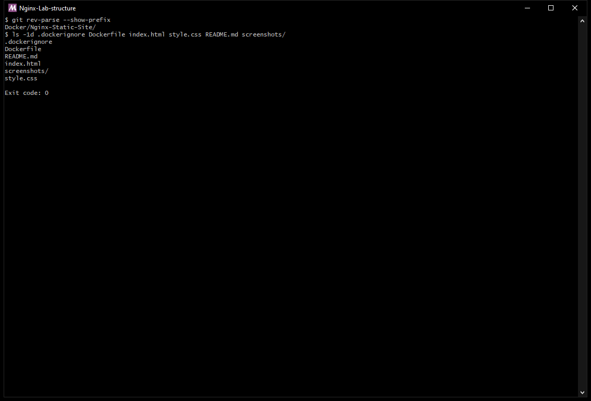

### Dockerfile

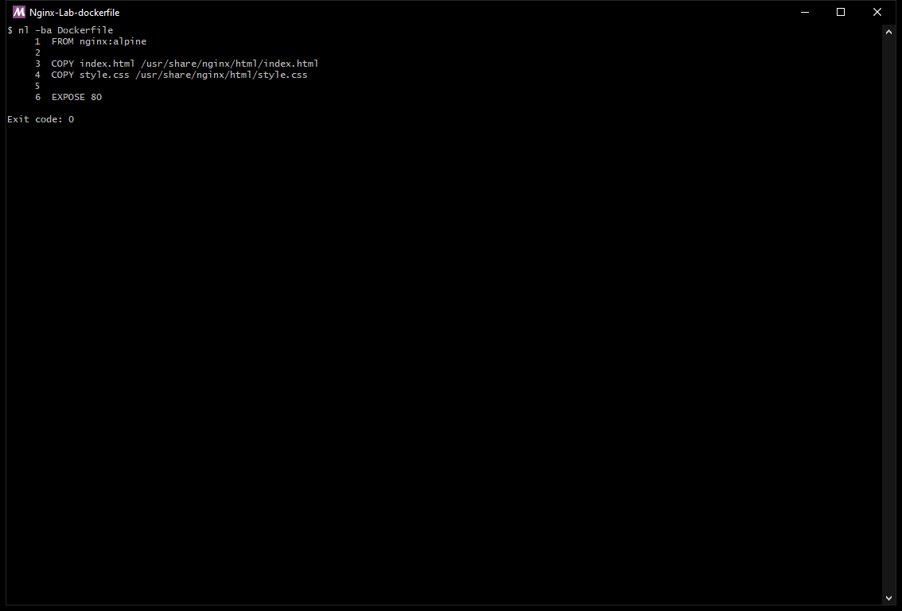

### Исходный HTML

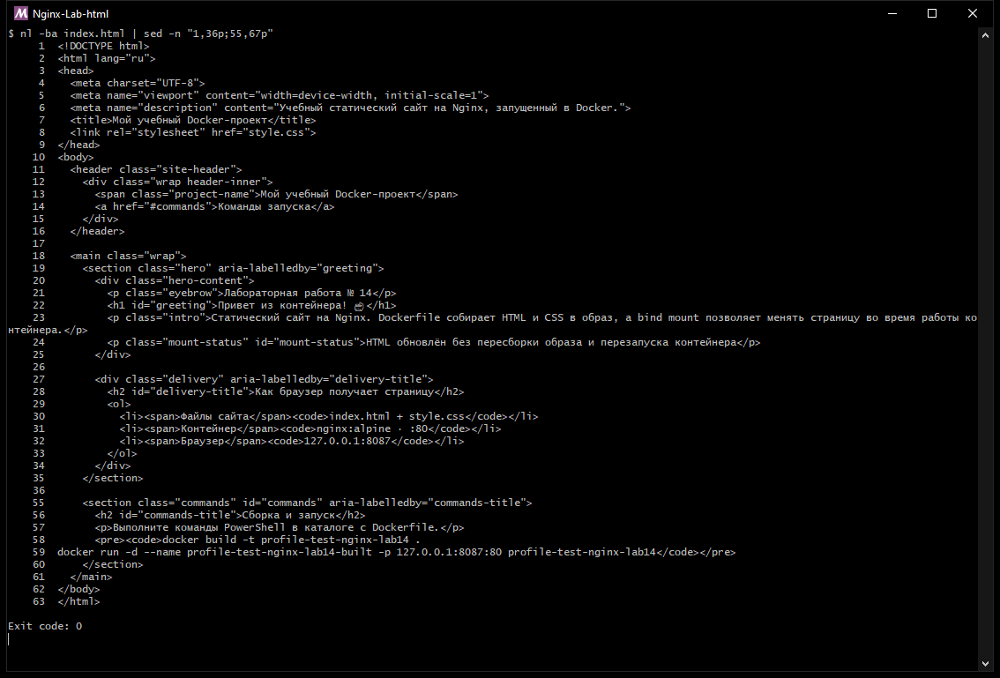

### Успешная сборка Docker-образа

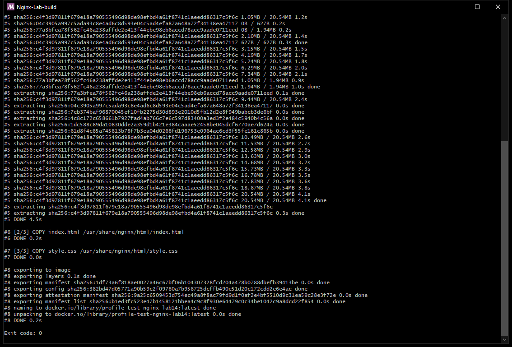

### Образ в локальном списке Docker

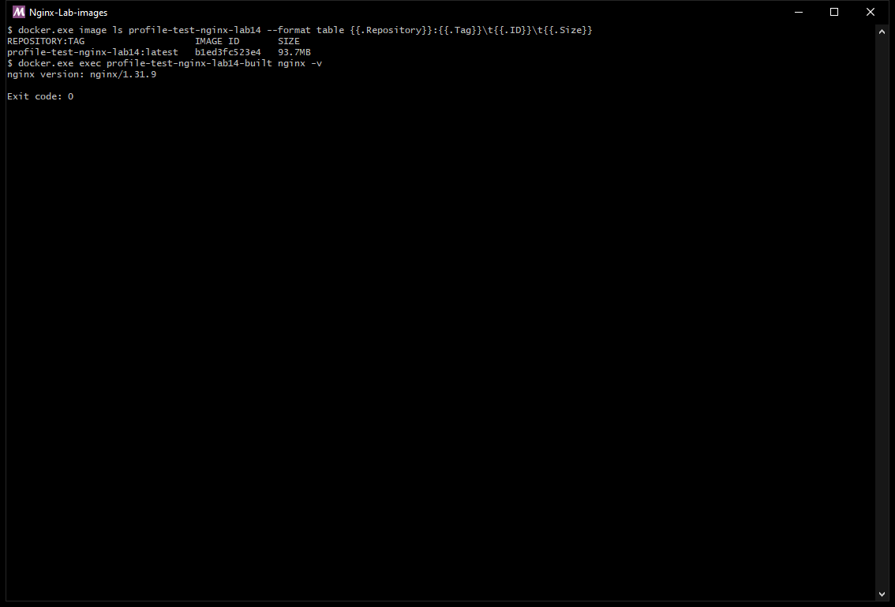

### Два запущенных контейнера

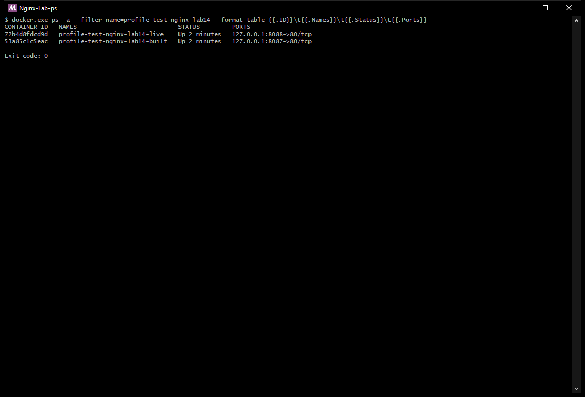

### Сайт из собранного образа на порту 8087

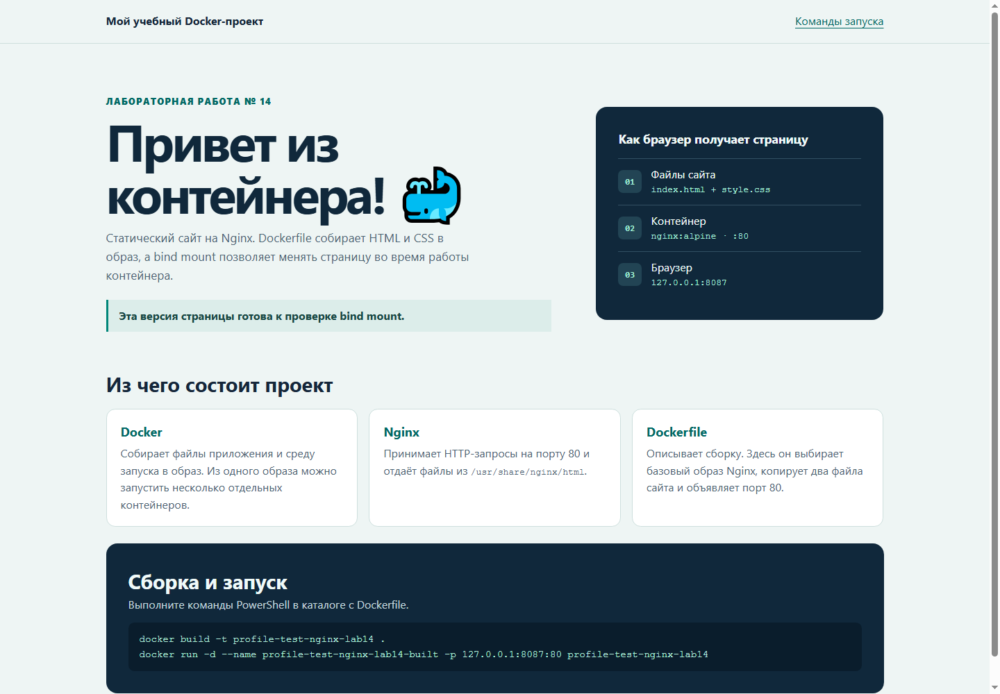

### Сайт с bind mount на порту 8088 до правки

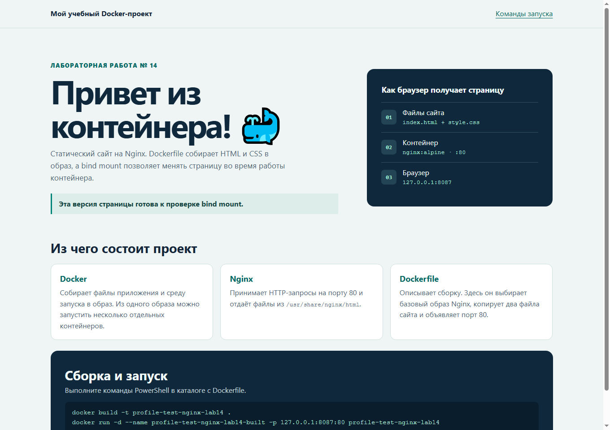

### Изменение в index.html

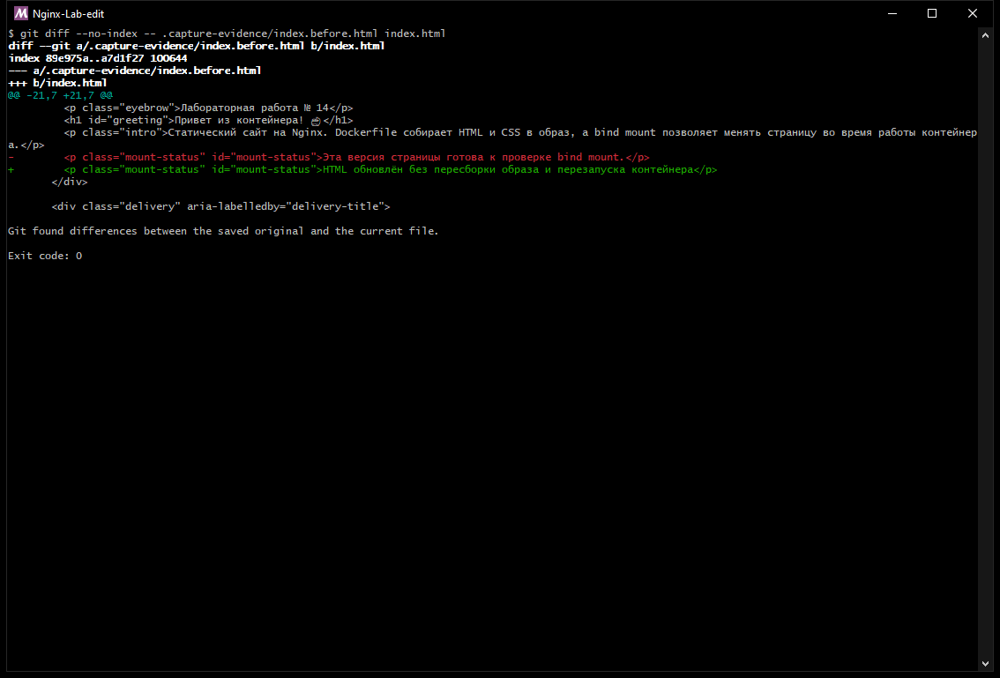

### Сайт с bind mount на порту 8088 после правки

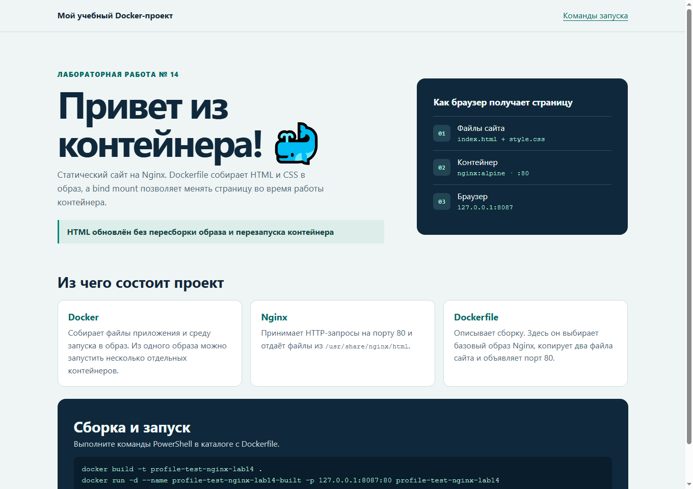

### Container ID, время запуска и ID образа до и после правки

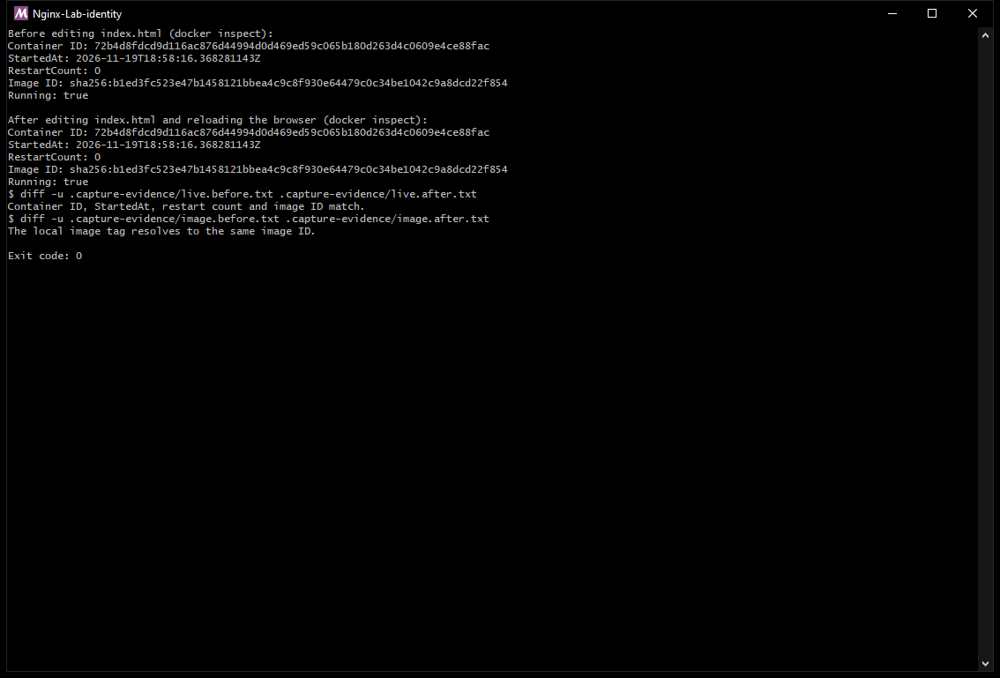

### Проверка Nginx, файлов и HTTP после перезапуска

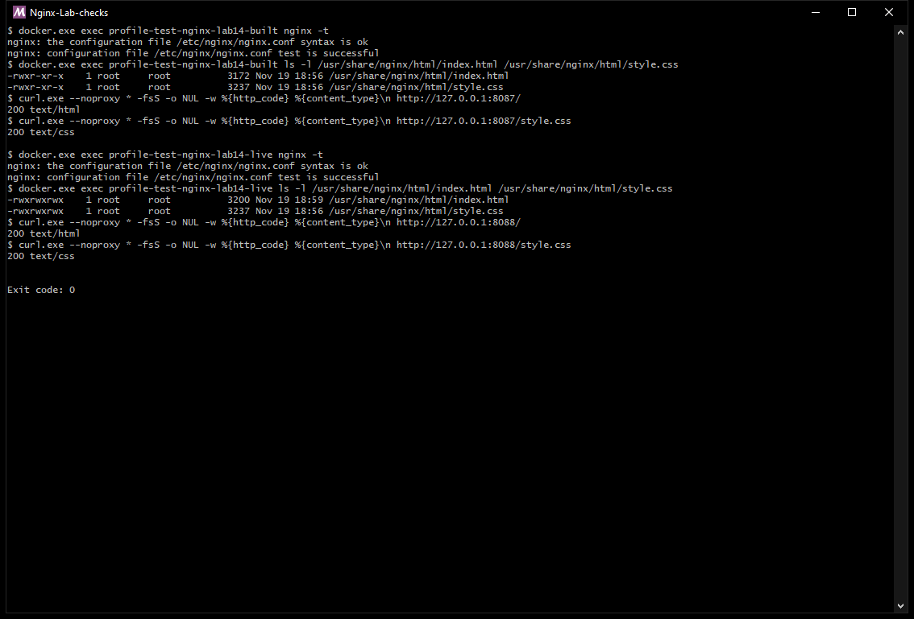
