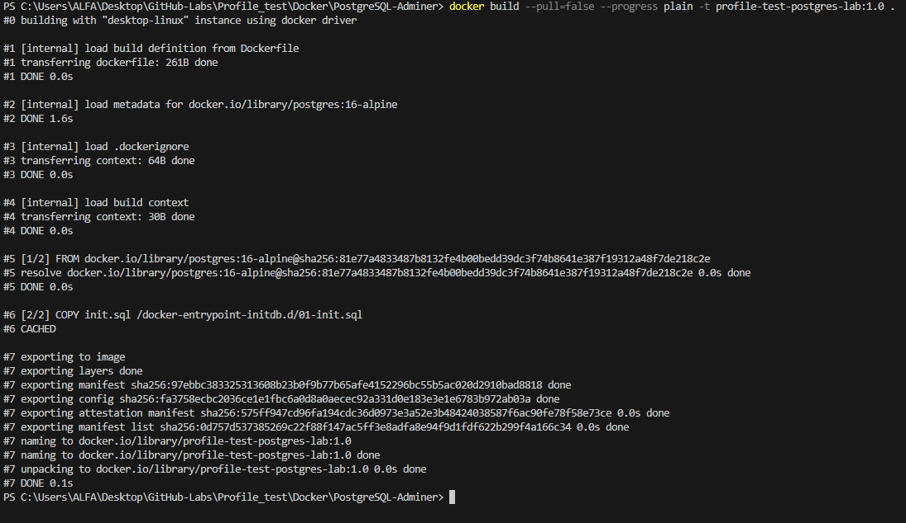
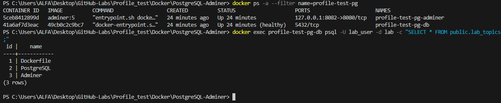
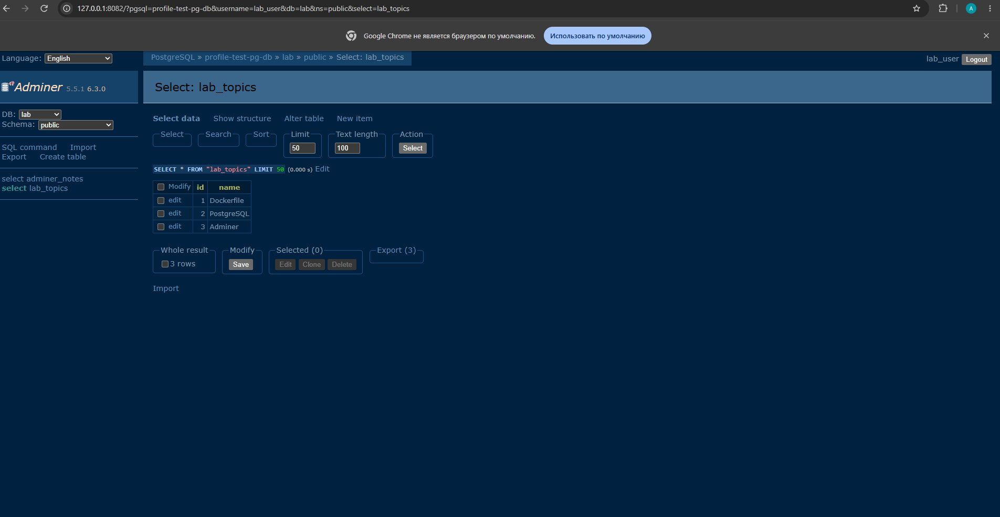

# Dockerfile и PostgreSQL + Adminer

Практическая работа по самостоятельному заданию «PostgreSQL + Adminer». PostgreSQL запускается из собственного образа, а Adminer предоставляет веб-интерфейс для подключения к базе. [Методичка по Dockerfile](https://github.com/rurewa/imfua/blob/main/content/Docker/Dockerfile/README.md) · [Задания для самостоятельной работы](https://github.com/rurewa/imfua/blob/main/content/StudentPracticalsLabs/DockerfileTasks.md)

`Dockerfile` расширяет образ `postgres:16-alpine`, добавляет в него `init.sql` и задаёт проверку готовности через `pg_isready`. При первом запуске с пустым томом PostgreSQL выполняет SQL-скрипт, создаёт таблицу `public.lab_topics` и добавляет в неё три строки. Данные сохраняются в томе `profile-test-pg-data`. [Документация образа PostgreSQL](https://hub.docker.com/_/postgres)

Контейнеры подключены к сети `profile-test-pg-net`. Adminer обращается к PostgreSQL по имени контейнера `profile-test-pg-db` через DNS этой сети. Внутри контейнера Adminer адрес `localhost` указывает на сам Adminer. В браузере доступен порт `127.0.0.1:8082`; порт PostgreSQL остаётся внутри Docker-сети. [Документация образа Adminer](https://hub.docker.com/_/adminer)

## Подготовка

Запустите Docker Desktop и перейдите в каталог работы из корня репозитория.

```powershell
cd Docker/PostgreSQL-Adminer
```

Скопируйте `.env.example` в `.env` и задайте случайный пароль в строке `POSTGRES_PASSWORD`. В PowerShell можно создать файл со случайным паролем командой ниже. Существующий `.env` сохраняется.

```powershell
if (-not (Test-Path -LiteralPath .env)) {
    $passwordBytes = New-Object byte[] 32
    $random = [System.Security.Cryptography.RandomNumberGenerator]::Create()
    try {
        $random.GetBytes($passwordBytes)
        $password = [Convert]::ToBase64String($passwordBytes)
        (Get-Content -Raw -LiteralPath .env.example).Replace(
            'POSTGRES_PASSWORD=', "POSTGRES_PASSWORD=$password"
        ) | Set-Content -LiteralPath .env -Encoding ASCII -NoNewline
    } finally {
        $random.Dispose()
    }
}
```

`.gitignore` исключает локальный `.env` из Git, а `.dockerignore` допускает в контекст сборки только Dockerfile и SQL-скрипт. Сохраните `.env` для следующих запусков с тем же томом.

## Сборка и первый запуск

```powershell
docker build --progress plain -t profile-test-postgres-lab:1.0 .
docker network create profile-test-pg-net
docker volume create profile-test-pg-data
docker run -d --name profile-test-pg-db --network profile-test-pg-net --env-file .env --mount type=volume,source=profile-test-pg-data,target=/var/lib/postgresql/data profile-test-postgres-lab:1.0
docker run -d --name profile-test-pg-adminer --network profile-test-pg-net --publish 127.0.0.1:8082:8080 --env ADMINER_DEFAULT_SERVER=profile-test-pg-db adminer:5
```

Для повторного запуска уже созданных контейнеров выполните `docker start profile-test-pg-db profile-test-pg-adminer`. Инициализация из `init.sql` выполняется только для пустого каталога данных.

## Проверка

```powershell
docker image ls profile-test-postgres-lab
docker ps -a --filter name=profile-test-pg
docker logs --tail 30 profile-test-pg-db
docker exec profile-test-pg-db pg_isready -h 127.0.0.1 -U lab_user -d lab
docker exec profile-test-pg-db psql -U lab_user -d lab -v ON_ERROR_STOP=1 -c "SELECT id, name FROM public.lab_topics ORDER BY id;"
curl.exe --silent --show-error --output NUL --write-out "%{http_code}" http://127.0.0.1:8082/
```

Дождитесь статуса `healthy` у PostgreSQL. SQL-запрос должен вернуть три строки с темами `Dockerfile`, `PostgreSQL` и `Adminer`. Код HTTP `200` подтверждает доступность веб-интерфейса.

### Результат проверочного запуска

- Образ `profile-test-postgres-lab:1.0` собрался. PostgreSQL получил статус `healthy`, контейнер Adminer — `Up`.
- Логи PostgreSQL подтвердили выполнение `01-init.sql`. Запрос через `psql` вернул `1 | Dockerfile`, `2 | PostgreSQL` и `3 | Adminer`.
- Adminer вернул HTTP `200`. Через его веб-интерфейс проверены вход в базу `lab`, чтение трёх строк и создание таблицы `adminer_notes`.

## Подключение в Adminer

1. Откройте `http://127.0.0.1:8082` и выберите систему **PostgreSQL**.
2. Укажите сервер `profile-test-pg-db`, пользователя `lab_user`, базу `lab` и пароль из локальной строки `POSTGRES_PASSWORD` в `.env`.
3. После входа откройте таблицу `public.lab_topics` и выберите просмотр данных.

Для проверки записи откройте раздел SQL-команд и выполните запрос. Он создаст таблицу `public.adminer_notes`, если её ещё нет.

```sql
CREATE TABLE IF NOT EXISTS public.adminer_notes (
    id integer GENERATED ALWAYS AS IDENTITY PRIMARY KEY,
    note text NOT NULL
);
```

## Скриншоты

### Сборка образа



### Контейнеры и SQL-запрос



### Таблица в Adminer


