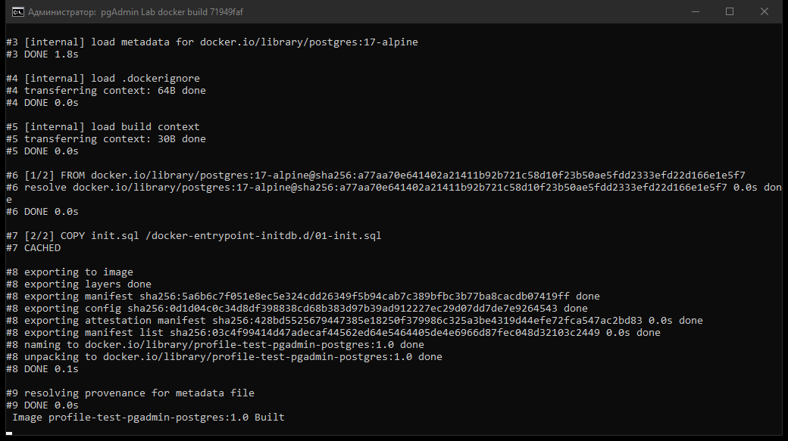
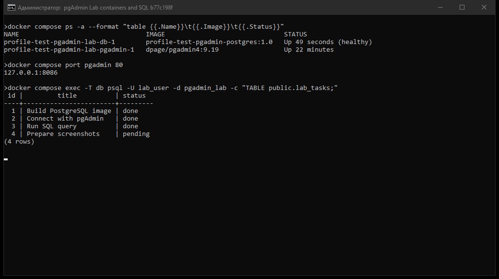
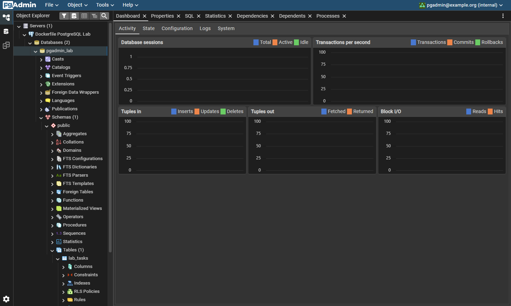
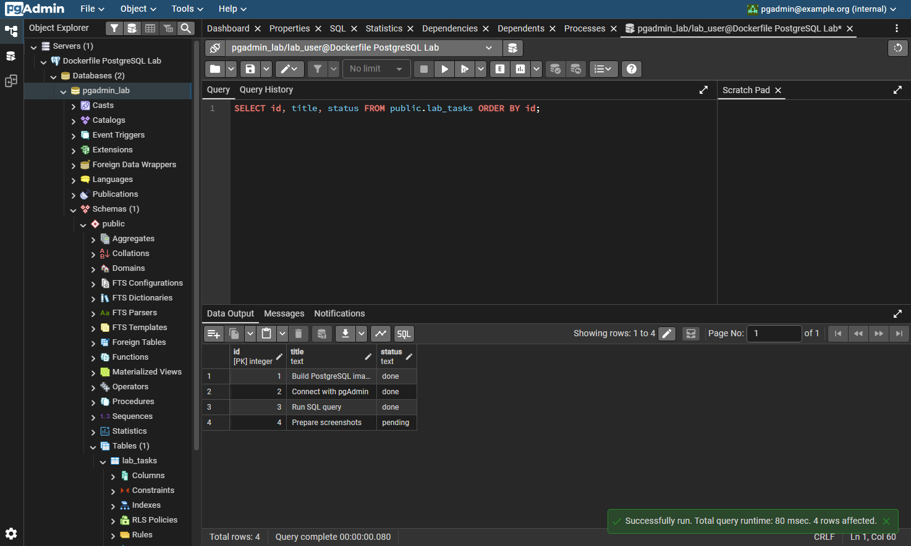

# Dockerfile — PostgreSQL + pgAdmin

Цель работы — собрать свой образ PostgreSQL с учебной базой и подключить к ней pgAdmin 4. Это самостоятельный вариант из раздела Dockerfile. SQL проверяется как через `psql`, так и через Query Tool в pgAdmin. [Методичка преподавателя](https://github.com/rurewa/imfua/blob/main/content/Docker/Dockerfile/README.md) · [Требования к оформлению](https://github.com/rurewa/imfua/blob/main/content/StudentPracticalsLabs/DockerfileTasks.md)

## Структура проекта

| Файл или папка | Назначение |
| --- | --- |
| `Dockerfile` | Расширяет `postgres:17-alpine`, копирует SQL в образ и задаёт проверку готовности. |
| `init.sql` | Создаёт таблицу `public.lab_tasks` и добавляет четыре записи. |
| `compose.yaml` | Запускает PostgreSQL и `dpage/pgadmin4:9.19` в общей сети с отдельными томами. |
| `servers.json` | Регистрирует сервер PostgreSQL в pgAdmin при первом запуске. |
| `.env.example` | Шаблон логина pgAdmin и двух паролей. |
| `.gitignore`, `.dockerignore` | Исключают локальный `.env` из Git и контекста сборки. |
| `screenshots/` | Снимки проверок. |

PostgreSQL доступен по имени `db` внутри сети Compose, на порту `5432`. pgAdmin доступен с компьютера по адресу `http://127.0.0.1:8086/`. Начальная база `pgadmin_lab` создаётся при первом запуске с пустым томом, затем PostgreSQL выполняет `init.sql`. pgAdmin сохраняет свои настройки в отдельном томе. [Образ PostgreSQL](https://hub.docker.com/_/postgres) · [Образ pgAdmin](https://www.pgadmin.org/download/pgadmin-4-container/) · [Импорт серверов](https://www.pgadmin.org/docs/pgadmin4/9.19/import_export_servers.html)

## Подготовка

Запустите Docker Desktop в режиме Linux-контейнеров. Из корня репозитория в PowerShell перейдите в каталог работы. Перед первым запуском проверьте порт.

```powershell
cd Docker/PostgreSQL-pgAdmin
Get-NetTCPConnection -LocalPort 8086 -State Listen -ErrorAction SilentlyContinue
```

Если порт занят, выберите другой свободный порт хоста в `compose.yaml` и используйте его в URL из README. Для первого запуска создайте `.env` по шаблону и задайте разные пароли для PostgreSQL и pgAdmin. Команды ниже генерируют оба пароля и сохраняют уже существующий `.env`.

```powershell
if (-not (Test-Path -LiteralPath .env)) {
    $random = [System.Security.Cryptography.RandomNumberGenerator]::Create()
    try {
        Get-Content -LiteralPath .env.example | ForEach-Object {
            if ($_ -match 'PASSWORD=$') {
                $bytes = New-Object byte[] 32
                $random.GetBytes($bytes)
                $_ + [Convert]::ToBase64String($bytes)
            } else {
                $_
            }
        } | Set-Content -LiteralPath .env -Encoding ASCII
    } finally {
        $random.Dispose()
    }
}
```

## Сборка и запуск

```powershell
docker compose config --quiet
docker compose --progress plain build db
docker compose up -d --no-build --wait --wait-timeout 90
```

Команда сборки создаёт образ `profile-test-pgadmin-postgres:1.0`. Compose запускает pgAdmin после того, как проверка `pg_isready` на PostgreSQL проходит успешно. После повторной сборки снова выполните `docker compose up` с параметрами из блока выше, чтобы применить новый образ.

## Проверка в терминале

```powershell
docker compose ps -a
docker compose port pgadmin 80
docker compose logs --tail 30 db pgadmin
docker compose exec -T db pg_isready -h 127.0.0.1 -U lab_user -d pgadmin_lab
docker compose exec -T db psql -U lab_user -d pgadmin_lab -v ON_ERROR_STOP=1 -c "SELECT id, title, status FROM public.lab_tasks ORDER BY id;"
docker compose exec -T db psql -U lab_user -d pgadmin_lab -v ON_ERROR_STOP=1 -c "SELECT status, count(*) FROM public.lab_tasks GROUP BY status ORDER BY status;"
curl.exe --silent --show-error --output NUL --write-out "%{http_code}" http://127.0.0.1:8086/login
```

В проверочном запуске оба контейнера получили статус `Up`, PostgreSQL — `healthy`. Лог PostgreSQL подтвердил выполнение `01-init.sql` и добавление четырёх строк. Первый запрос через `psql` вернул все записи, второй — три записи со статусом `done` и одну со статусом `pending`. Страница входа pgAdmin ответила HTTP `200`. Порт PostgreSQL на хосте не опубликован.

## Подключение через pgAdmin

1. Откройте `http://127.0.0.1:8086/` и войдите с `PGADMIN_DEFAULT_EMAIL` и `PGADMIN_DEFAULT_PASSWORD` из локального `.env`.
2. В **Object Explorer** раскройте **Servers → Dockerfile PostgreSQL Lab**. Введите пароль PostgreSQL из `POSTGRES_PASSWORD` и оставьте **Save Password** выключенным.
3. Раскройте **Databases → pgadmin_lab → Schemas → public → Tables**. В списке будет таблица `lab_tasks`. Настройки подключения берутся из `servers.json`. Сервер использует адрес `db`, порт `5432` и пользователя `lab_user`.
4. Выберите базу `pgadmin_lab`, откройте **Tools → Query Tool**, вставьте запрос и нажмите **Execute script**. Если Query Tool снова запросит пароль подключения, введите `POSTGRES_PASSWORD` из `.env` и оставьте **Save Password** выключенным.

```sql
SELECT id, title, status FROM public.lab_tasks ORDER BY id;
```

В проверочном запуске pgAdmin подключился к базе через сеть Compose. Query Tool вернул те же четыре строки, что и `psql`.

## Скриншоты

### Сборка образа



### Контейнеры и SQL в терминале



### Подключение к базе в pgAdmin



### Результат SQL в pgAdmin



## Остановка и повторный запуск

```powershell
docker compose stop
docker compose start
```

Выполняйте команды из каталога этой практики. Тома PostgreSQL и pgAdmin сохраняются между запусками.
