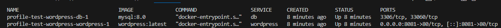
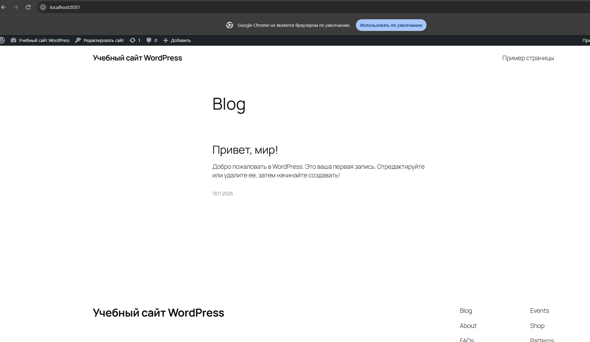
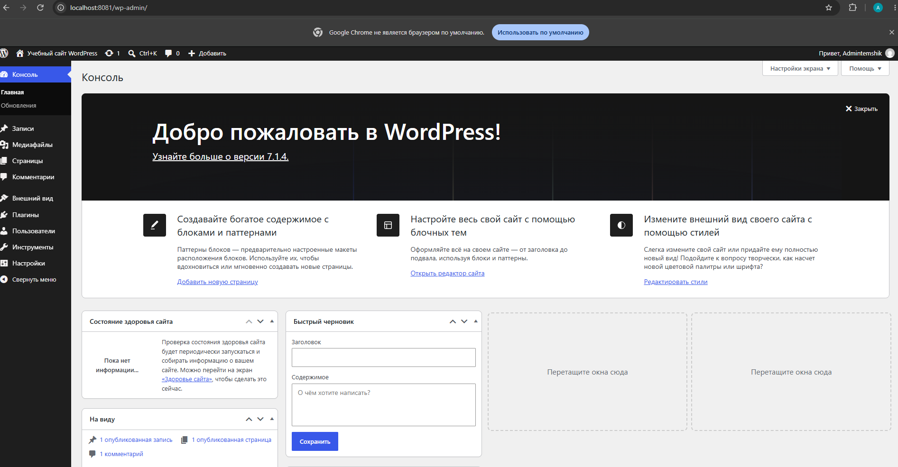

# Docker Compose и WordPress

Практическая работа по запуску WordPress и MySQL в Docker Compose. [Методичка](https://github.com/rurewa/imfua/blob/main/content/Docker/DockerCompose/WordPress.md)

Сервис `wordpress` использует официальный образ `wordpress:latest` с Apache и доступен по адресу `http://localhost:8081`. Сервис `db` использует образ `mysql:8.0`. WordPress подключается к MySQL по адресу `db:3306` через сеть `wp-network`. Том `db_data` хранит данные MySQL, а `wordpress_data` — файлы WordPress, включая темы, плагины и загрузки.

## Подготовка

Запустите Docker Desktop. Из корня репозитория перейдите в каталог практики и проверьте список запущенных проектов.

```powershell
cd Docker/WordPress
docker compose ls
```

При первом запуске скопируйте `.env.example` в `.env` и заполните `MYSQL_ROOT_PASSWORD` и `MYSQL_PASSWORD` двумя разными случайными паролями. Первый используется для администратора MySQL, второй — для пользователя базы данных WordPress. Файл `.env` исключён из Git. Сохраните его для следующих запусков с тем же томом MySQL.

В PowerShell можно создать `.env` командой ниже. Она сохраняет существующий файл, если он уже есть.

```powershell
if (-not (Test-Path -LiteralPath .env)) {
    $random = [System.Security.Cryptography.RandomNumberGenerator]::Create()
    try {
        Get-Content -LiteralPath .env.example | ForEach-Object {
            $bytes = New-Object byte[] 32
            $random.GetBytes($bytes)
            $_ + [Convert]::ToBase64String($bytes)
        } | Set-Content -LiteralPath .env -Encoding ASCII
    } finally {
        $random.Dispose()
    }
}
```

## Запуск и проверка

```powershell
docker compose config --quiet
docker compose up -d
docker compose ps -a
docker compose logs --tail 50 wordpress db
```

Проверка конфигурации завершается без вывода при успехе. После запуска оба контейнера должны быть в состоянии `Up` (в таблице может отображаться `Running`). В логах `db` дождитесь сообщения `ready for connections` для порта `3306`. В логах `wordpress` проверьте запуск Apache. Для просмотра новых записей выполните `docker compose logs -f wordpress` или `docker compose logs -f db`. Нажмите `Ctrl+C`, чтобы выйти из просмотра.

## Установка WordPress в браузере

1. Откройте `http://localhost:8081`, выберите язык и нажмите «Продолжить».
2. Введите название сайта, имя администратора и свой адрес электронной почты. Сохраните предложенный WordPress пароль в менеджере паролей или задайте свой.
3. Нажмите «Установить WordPress». После установки нажмите «Войти» и введите учётные данные администратора. Панель управления доступна по адресу `http://localhost:8081/wp-admin/`.
4. В панели управления наведите курсор на название сайта в верхней панели и нажмите «Перейти на сайт».

## Скриншоты

### Контейнеры Docker



### Главная страница WordPress



### Панель управления WordPress



## Управление контейнерами

Команда `docker compose stop` останавливает контейнеры с сохранением данных. Для повторного запуска используйте `docker compose start`, для перезапуска — `docker compose restart`.
