# Лабораторная № 13 — Docker Compose и drawDB

Цель — развернуть официальный редактор drawDB через Docker Compose, спроектировать ER-диаграмму «Колледж» и экспортировать её. drawDB работает в браузере, моделирует структуры таблиц и генерирует SQL. В этой работе развёрнут редактор схем, а SQL проверен отдельно как файл экспорта. [Методичка преподавателя](https://github.com/rurewa/imfua/blob/main/content/Docker/DockerCompose/drawDB.md) · [Официальный drawDB](https://github.com/drawdb-io/drawdb)

## Версия и конфигурация

Проверен коммит `53cf4109fa6bfa6d192c1082ac340dc3cccb95f7`. Официальный `compose.yml` запускает сервис `drawdb` на образе `node:20-alpine` с командой `npm install && npm run dev -- --host`. Vite 8.3.5 обслуживает порт 5173. Docker-образ приложения отдельно собирать не требуется для этого способа запуска. [Upstream compose.yml](https://github.com/drawdb-io/drawdb/blob/53cf4109fa6bfa6d192c1082ac340dc3cccb95f7/compose.yml) · [Upstream README](https://github.com/drawdb-io/drawdb/blob/53cf4109fa6bfa6d192c1082ac340dc3cccb95f7/README.md)

| Файл или каталог | Назначение |
| --- | --- |
| [compose.local.yml](compose.local.yml) | Дополнение к официальному Compose-файлу. |
| [exports/](exports/) | Изображение, SQL для MySQL и JSON для восстановления схемы. |
| [screenshots/](screenshots/) | Снимки реально выполненных действий. |

## Клонирование и запуск

Команды PowerShell выполняются из корня `Profile_test`. Для клона создаётся отдельная папка в каталоге временных файлов. YAML-тег `!override` требует Docker Compose 2.24.4 или новее.

~~~powershell
$lab = Join-Path (Get-Location).Path 'Docker/drawDB'
$upstream = Join-Path ([IO.Path]::GetTempPath()) ('drawdb-lab13-' + [Guid]::NewGuid().ToString('N').Substring(0,8))
git clone --depth 1 https://github.com/drawdb-io/drawdb.git $upstream
git -C $upstream fetch --depth 1 origin 53cf4109fa6bfa6d192c1082ac340dc3cccb95f7
git -C $upstream switch --detach 53cf4109fa6bfa6d192c1082ac340dc3cccb95f7

$compose = @(
    '--project-name', 'profile-test-drawdb-lab',
    '--project-directory', $upstream,
    '-f', (Join-Path $upstream 'compose.yml'),
    '-f', (Join-Path $lab 'compose.local.yml')
)
docker compose @compose config --quiet
docker compose @compose up -d
docker compose ls
docker compose @compose ps -a
docker compose @compose logs --tail 50
~~~

Дождитесь сообщения `VITE v8.3.5 ready` и откройте [http://localhost:5173/](http://localhost:5173/). Первый запуск устанавливает зависимости. Для проверки HTTP можно выполнить `curl.exe --head http://localhost:5173/`.

Локальный override сохраняет команду и образ upstream. Команда запуска задаёт отдельное имя Compose-проекта. Дополнение задаёт имя контейнера, привязку `127.0.0.1:5173` и том `node_modules` для зависимостей. Исходники остаются во временном клоне. Настройки и схемы drawDB сохраняются в **IndexedDB** профиля браузера для адреса `http://localhost:5173`. Из другого профиля схему можно открыть через экспортированный JSON. [Хранилище drawDB](https://github.com/drawdb-io/drawdb/blob/53cf4109fa6bfa6d192c1082ac340dc3cccb95f7/src/data/db.js)

## ER-диаграмма «Колледж»

В редакторе выбран диалект **MySQL**. В пустой диаграмме проверено добавление таблицы через **Add table**. Через **File → Import from SQL** импортированы пять исходных определений. В редакторе столбцов выставлен `DATE` для `grades.grade_date`. Все пять внешних ключей созданы перетаскиванием поля FK к первичному ключу в холсте. После автоматического размещения увеличена ширина таблиц и разведены линии.

| Таблица | Поля |
| --- | --- |
| `students` | `id INT PK`, `full_name VARCHAR(100)`, `group_id INT FK`, `enrollment_date DATE` |
| `groups` | `id INT PK`, `group_name VARCHAR(30)`, `curator_id INT FK` |
| `teachers` | `id INT PK`, `full_name VARCHAR(100)`, `department VARCHAR(100)` |
| `courses` | `id INT PK`, `course_name VARCHAR(100)`, `teacher_id INT FK` |
| `grades` | `id INT PK`, `student_id INT FK`, `course_id INT FK`, `grade INT`, `grade_date DATE` |

Связи от внешних ключей к первичным имеют кардинальность «многие к одному».

- `students.group_id` → `groups.id`
- `groups.curator_id` → `teachers.id`
- `courses.teacher_id` → `teachers.id`
- `grades.student_id` → `students.id`
- `grades.course_id` → `courses.id`

## Экспорт

- [college.png](exports/college.png) — изображение холста, 5456 × 3692.
- [college.sql](exports/college.sql) — экспорт MySQL с пятью `CREATE TABLE`, пятью первичными и пятью внешними ключами.
- [college.json](exports/college.json) — полноценная схема drawDB. Для восстановления откройте **File → Import from → JSON** и загрузите файл.

Файлы экспортированы из меню drawDB. В MySQL-экспорте `INT` представлен синонимом `INTEGER`. Ограничения добавлены через `ALTER TABLE ... ADD FOREIGN KEY ... REFERENCES ... ON UPDATE NO ACTION ON DELETE NO ACTION`. Экспорт проверен по содержимому без выполнения запросов в базах прошлых лабораторных.

## Проверка и управление

| Проверка | Результат |
| --- | --- |
| Compose и HTTP | Конфигурация валидна, контейнер `Up`. До и после перезапуска получен HTTP 200. |
| Браузер | Открылись главная страница, мастер, холст и меню экспорта. Проверены добавление таблицы, редактирование столбца и создание связей. |
| Схема | Подтверждены 5 таблиц, 18 полей, 5 первичных ключей и 5 связей на нужные поля `id`. |
| После перезапуска | Изменилось время старта только контейнера drawDB. Диаграмма восстановлена из IndexedDB в том же профиле, SHA-256 всех трёх файлов совпали. |

Остановить сервис с сохранением контейнера, снова запустить или перезапустить его можно командами ниже.

~~~powershell
docker compose @compose stop
docker compose @compose start
docker compose @compose restart
~~~

`docker compose @compose down` удаляет контейнер и сеть только этого проекта. Именованный том зависимостей сохраняется. Опция `--volumes` дополнительно удаляет том. JSON, SQL и PNG находятся в каталоге лабораторной.

## Отличия от методички

- Официальный Compose-файл сохранён. Локальный override добавляет изоляцию имени контейнера, привязку к loopback и рабочий том для npm. Порт 5173 сохранён.
- В методичке пример банковской схемы. Здесь спроектирована схема «Колледж».
- Для проверки сохранности выполнен перезапуск только drawDB. Перенос диаграммы между браузерами выполняется через JSON.

При установке зависимостей `npm` сообщил об одной уязвимости уровня moderate. Для воспроизводимости оставлены зависимости зафиксированного коммита upstream. Сервис слушает только loopback-интерфейс.

## Скриншоты

### Официальный upstream, коммит и compose.yml

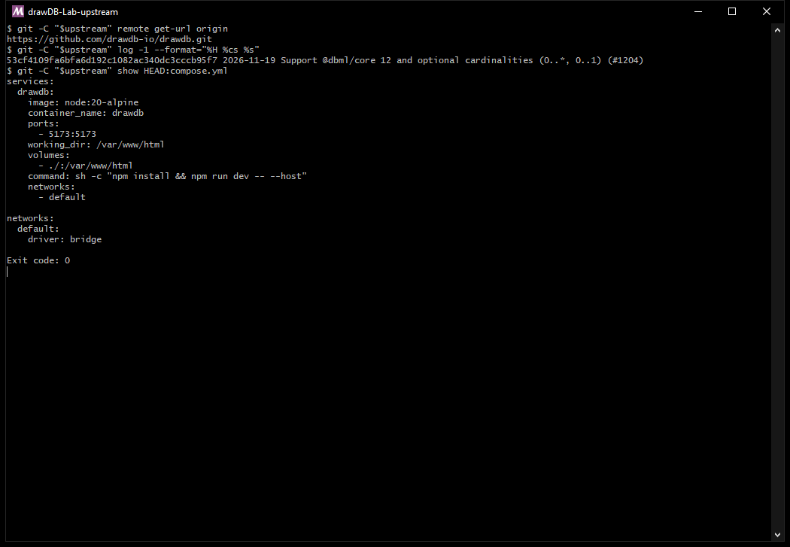

### Структура лабораторной

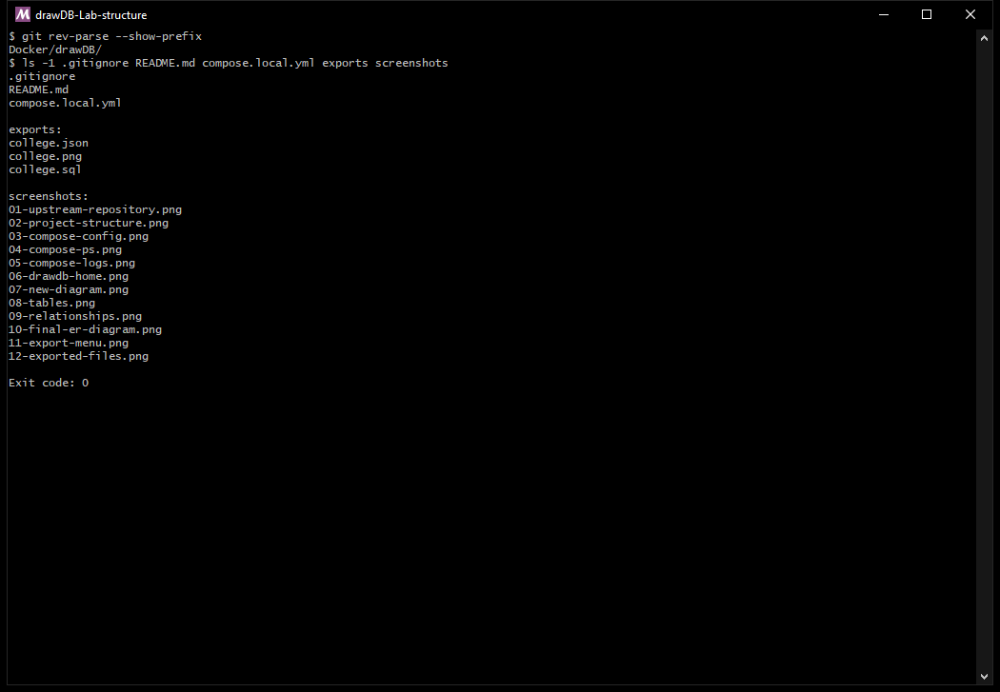

### Проверка конфигурации Compose

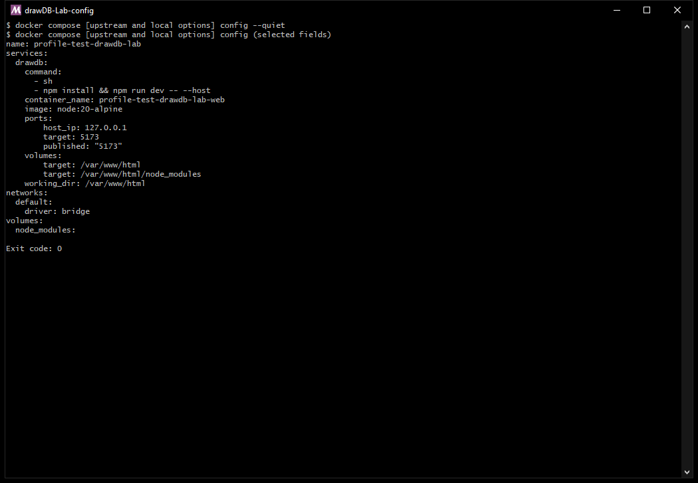

### Рабочий контейнер drawDB

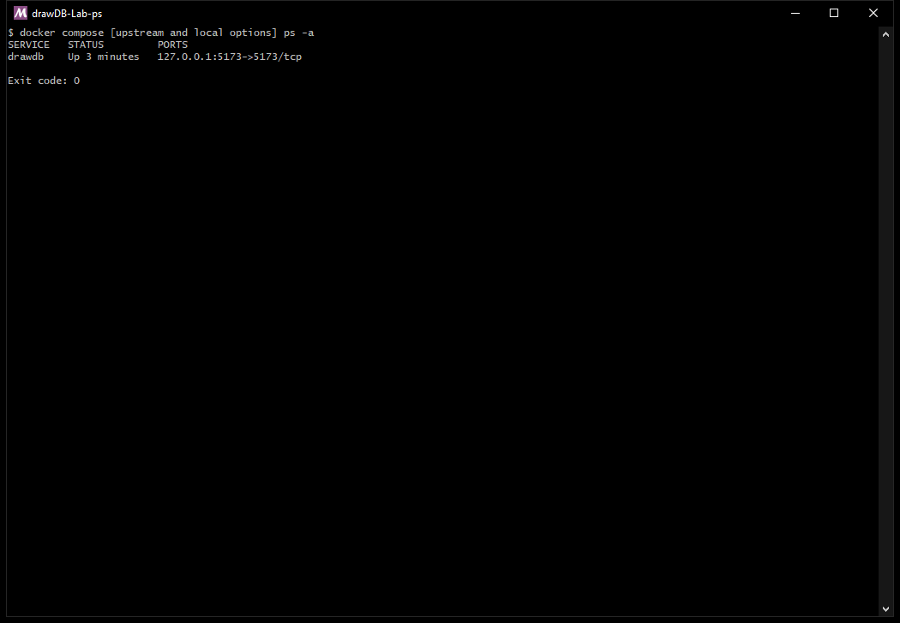

### Журнал запуска Vite

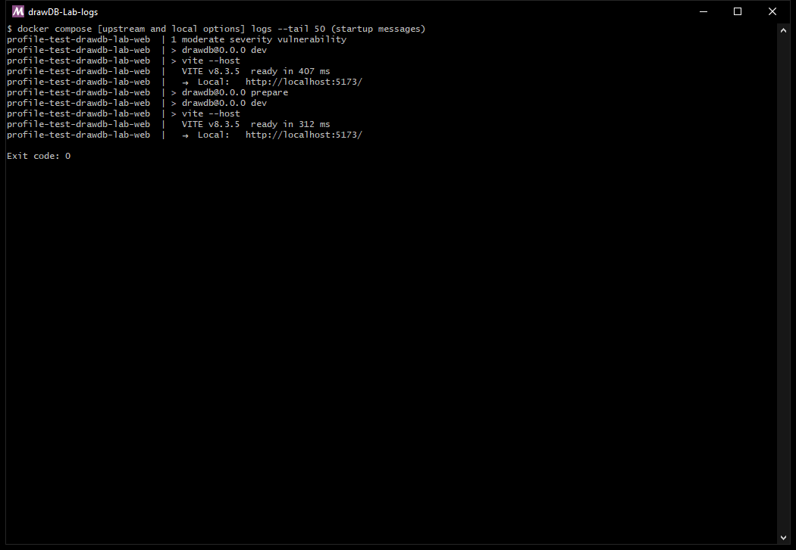

### Главная страница drawDB

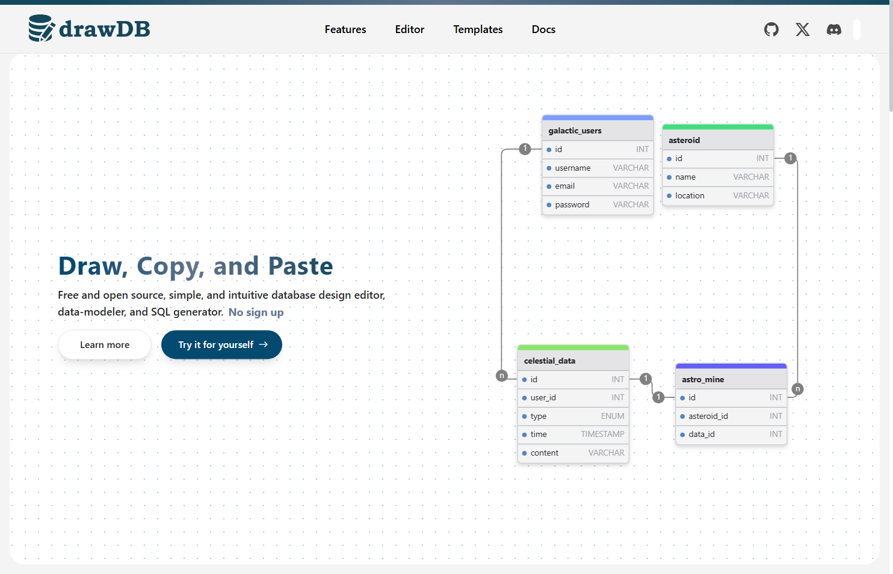

### Мастер новой диаграммы

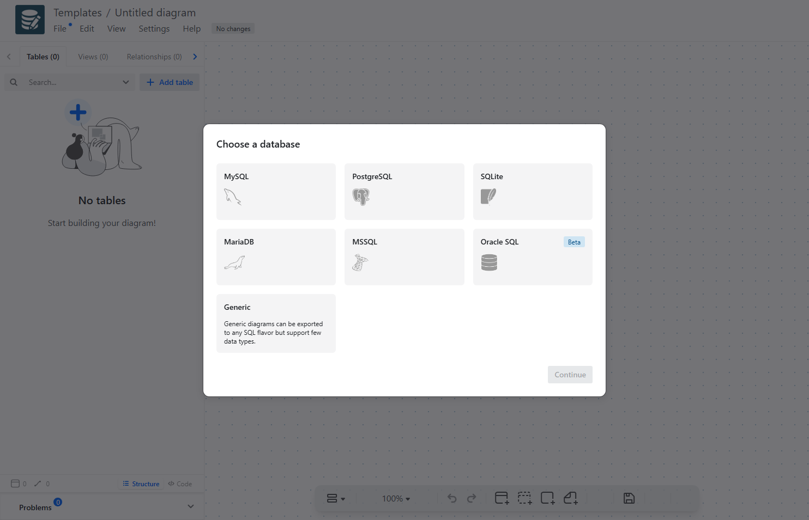

### Пять таблиц до добавления связей

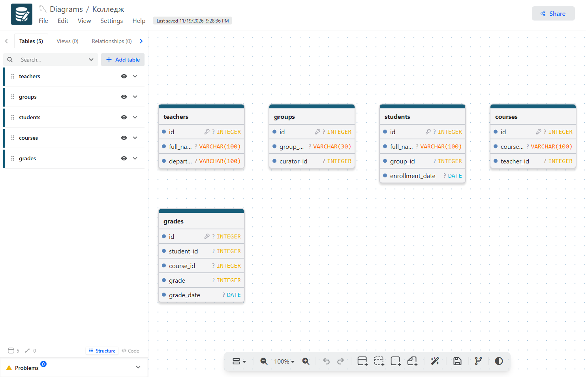

### Пять связей на холсте и в боковой панели

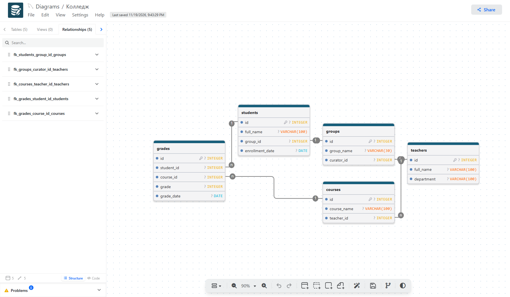

### Итоговая ER-диаграмма «Колледж»

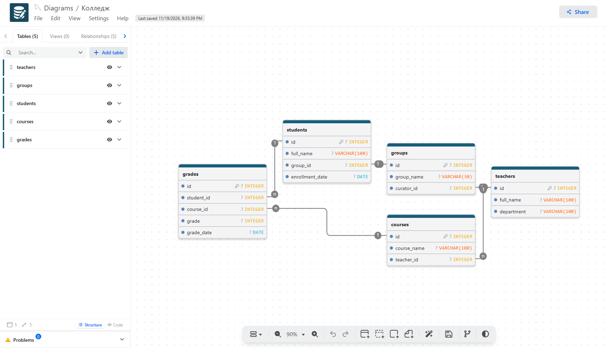

### Меню экспорта drawDB

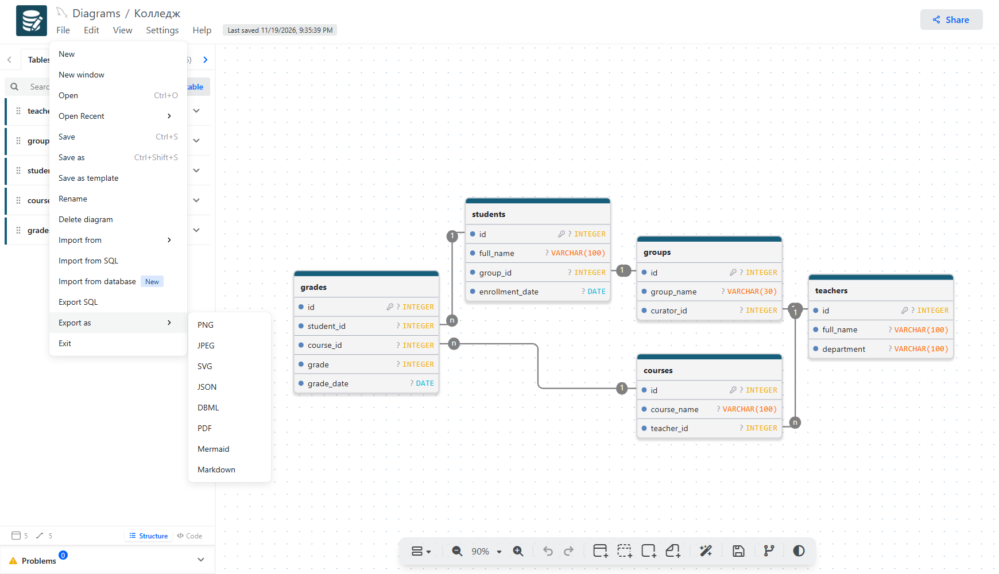

### Файлы экспорта и их контрольные суммы

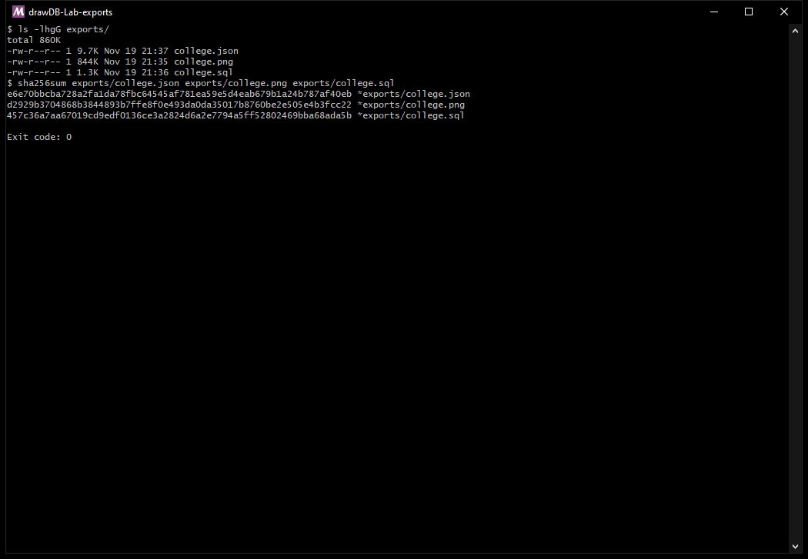
